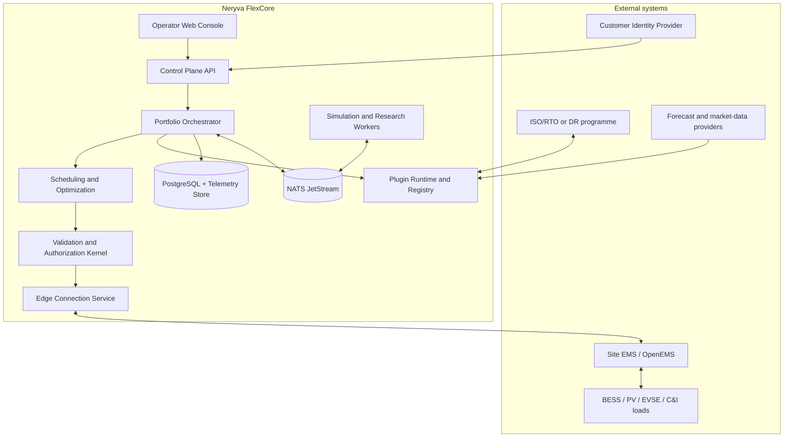
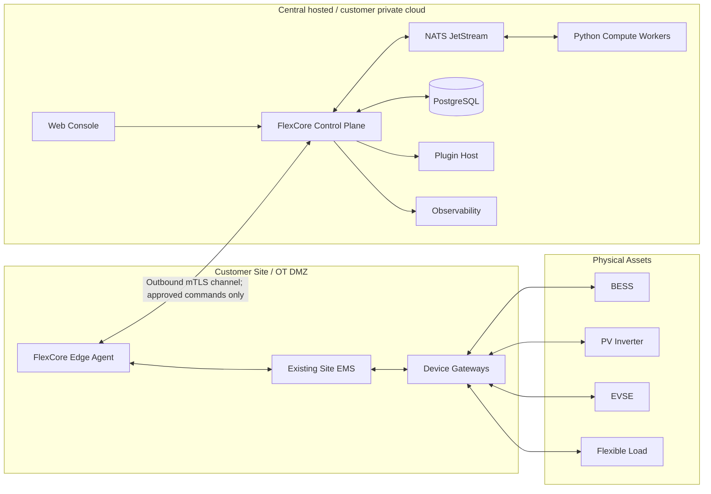
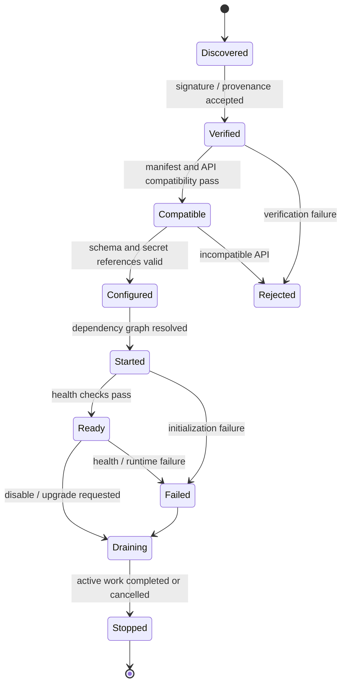
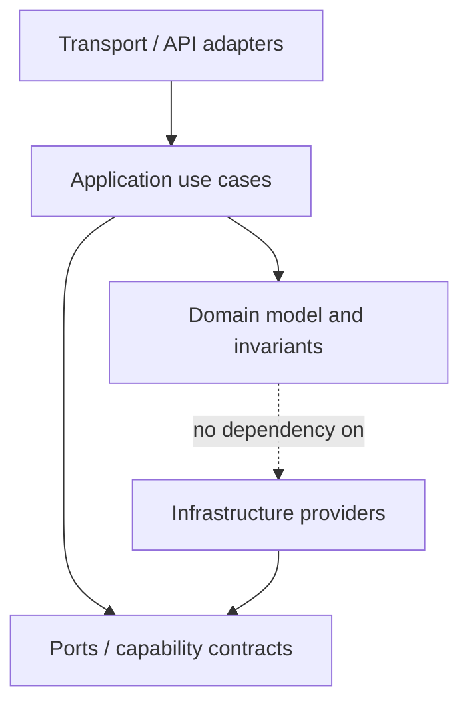
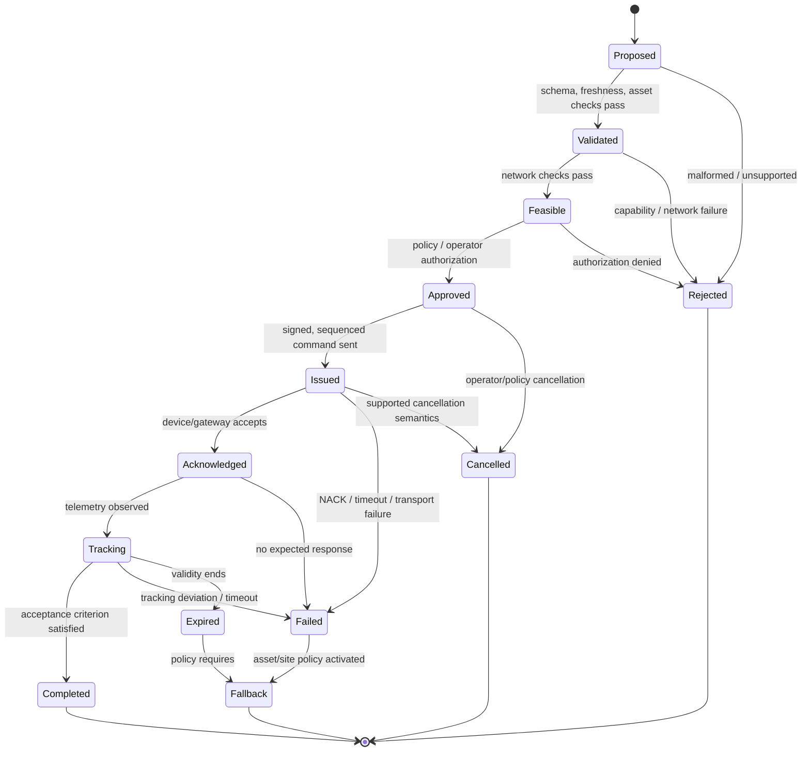

# Neryva FlexCore
## Product Definition, System Design, and High-Level Architecture

**Document type:** Product and Principal Engineering Architecture Report  
**Version:** 1.0  
**Status:** Proposed architectural baseline for design review; not a certification or permission for live grid control  
**Prepared for:** Neryva  
**Research cut-off:** 6 November 2026  
**Primary implementation language:** Rust  
**Supporting languages:** Python and TypeScript  
**License recommendation:** Apache-2.0 for core software, with separate review for protocol specifications, datasets, models, and third-party dependencies

---

## 0. Executive decision

Neryva should build **FlexCore: an open-source, modular Virtual Power Plant (VPP) orchestration and distribution-aware Distributed Energy Resource (DER) coordination platform**.

FlexCore is an **enterprise web application backed by a central control plane, with optional site-level edge connectors and a simulation/research environment**. It is not a mobile app, a household energy calculator, a general-purpose AI chatbot, a replacement for an ISO/RTO market platform, a utility ADMS/SCADA system, or a protective relay controller.

The first commercially credible product should target organizations that aggregate or operate portfolios of distributed energy resources:

1. VPP and DER aggregators;
2. commercial and industrial (C&I) energy portfolio operators;
3. microgrid and multi-site energy operators; and
4. energy service companies and system integrators.

Utilities and distribution system operators (DSOs) are an important later audience, but FlexCore should not initially claim to be a fully qualified utility DERMS or a replacement for an ADMS. Direct ISO/RTO market participation is a region-specific integration, not a universal core function.

### 0.1 What the product does

FlexCore provides a common operational layer to:

- register sites, assets, electrical topology, capability limits, and operating constraints;
- ingest and validate telemetry from DERs and site energy-management systems;
- estimate the dispatchable flexibility available across an asset portfolio;
- create day-ahead and intraday schedules for an aggregated portfolio;
- validate candidate schedules against resource and network constraints;
- manage the authorization, issue, acknowledgement, and measured-response lifecycle of dispatch commands;
- connect to site systems and market/program interfaces through replaceable adapters;
- give operators a traceable explanation of why a schedule or command was accepted, rejected, or changed; and
- run repeatable simulation and research experiments before any real-world control is enabled.

### 0.2 Architectural decision

Use a **plugin-oriented modular monolith** for the central platform, with explicit process boundaries where they provide meaningful security, scaling, runtime, or fault-isolation benefits:

- Rust control-plane application and domain modules;
- Rust site edge agent / connector;
- Python numerical and research workers for power-system modelling and ML;
- React + TypeScript operator web application;
- PostgreSQL for authoritative transactional state;
- NATS JetStream for durable internal events and work distribution;
- gRPC/Protocol Buffers for internal service and worker contracts;
- REST/OpenAPI for the external application API;
- Wasmtime + WebAssembly Component Model/WIT for constrained third-party plugins; and
- established power-system simulators and protocol implementations rather than reimplementing them.

**Core principle:** everything that is safely replaceable should be an extension point; safety invariants, authorization, tenant isolation, command lifecycle, audit, and final dispatch validation must remain controlled by the platform kernel.

### 0.3 What is deliberately not promised

The first release does not promise:

- hard real-time or protection-grade control;
- primary frequency response or synthetic inertia control;
- autonomous grid switching or protection-system operation;
- universal AC-OPF global optimality;
- universal market qualification or FERC Order 2222 compliance;
- certified OpenADR, IEEE 2030.5, IEC 61850, SunSpec, or OCPP conformance merely by implementing an adapter;
- safe field dispatch without site-specific integration, commissioning, cyber review, and hardware-in-the-loop validation; or
- that GNN or MARL outputs are safe by construction.

These are separate qualification and research tracks.

---

# 1. Product definition and application

## 1.1 Product statement

> **Neryva FlexCore is an open, modular orchestration platform for aggregating, scheduling, and coordinating distributed energy resources under asset, portfolio, and distribution-network constraints.**

FlexCore helps energy operators turn a heterogeneous DER fleet into a portfolio with measurable availability, dispatchable flexibility, and auditable operating decisions.

The product is an orchestration and coordination layer. It is designed to integrate with existing site EMS/edge platforms, devices, simulators, and market systems rather than replace every component in the energy stack.

## 1.2 What kind of application is this?

FlexCore is a **multi-surface enterprise software product**:

| Surface | Form | Primary responsibility |
|---|---|---|
| Operator Console | Browser-based web application | Fleet operations, planning, approvals, dispatch monitoring, audit, and configuration |
| Control Plane | Rust server application | Domain workflows, portfolio coordination, authorization, scheduling, plugin composition, APIs, and command orchestration |
| Site Edge Agent | Linux daemon/container deployed at a site or in an OT DMZ | Secure site connectivity, protocol adaptation, buffering, local integration, and forwarding of approved schedules/commands |
| Numerical / Research Workers | Isolated Python services or simulation processes | Power flow, optimization research, forecasting, GNN, MARL, and simulator integration |
| Plugin SDK | Rust crates, WIT interfaces, Protobuf contracts, and examples | Third-party and first-party extensions |
| Simulation Lab | CLI + web workflows + simulator adapters | Scenario creation, replay, stress testing, benchmarking, and demonstrations |
| External API | REST/OpenAPI and selected gRPC APIs | Integration with enterprise systems and partner applications |

The operator console is the primary user-facing application. The platform is not a single desktop binary. Site edge software is a separate deployment because it crosses an enterprise IT/operational technology boundary.

## 1.3 Primary users and audiences

### Primary audience for the first product generation

| Role / organization | Problem FlexCore addresses |
|---|---|
| VPP / DER aggregator operator | Need to understand fleet capacity, available flexibility, operating limits, and dispatch performance across many sites |
| C&I portfolio operator | Need to coordinate batteries, PV, flexible loads, and EV charging across multiple facilities |
| Microgrid operator | Need coordinated scheduling of local generation, storage, and controllable loads while maintaining site constraints |
| Energy service company (ESCO) | Need a reusable orchestration layer across customer sites and equipment vendors |
| Energy systems integrator | Need extensible interfaces and a common platform to connect customer assets, telemetry, and optimization components |

### Secondary audience

- DSO / utility planning and DER integration teams;
- grid engineers and power-system researchers;
- market operations and energy trading teams;
- DER device and EMS vendors;
- universities and open-source contributors; and
- regional market-interface implementers.

### Not the initial target

- residential consumers managing one home;
- individual solar installers looking only for proposal software;
- ISOs/RTOs seeking a replacement for their market or control-room platforms;
- TSOs seeking a replacement for EMS/SCADA or transmission control; and
- operators seeking a certified protection, relay, or inverter inner-loop controller.

## 1.4 Initial operating scenario

The initial design should support a VPP aggregator coordinating a portfolio composed of several simulated or connected sites. Each site may contain one or more of:

- battery energy storage systems (BESS);
- photovoltaic (PV) inverters;
- controllable commercial or industrial loads;
- EV supply equipment / charging stations;
- meters and site controllers; and
- a site-level EMS such as OpenEMS.

The platform estimates each resource's available power and energy flexibility, aggregates the site capabilities, creates a schedule, validates the schedule against known network and asset constraints, and manages a controlled dispatch workflow.

## 1.5 Supported operational use cases

### First-generation use cases

1. **Portfolio visibility:** asset status, available capacity, state of charge, availability, alarms, telemetry quality, and site connectivity.
2. **Flexibility estimation:** determine what each asset and portfolio can safely offer over a defined interval and horizon.
3. **Day-ahead and intraday scheduling:** allocate an aggregate target across assets subject to capability and energy constraints.
4. **Peak management:** coordinate storage and flexible loads against a site or feeder import/export limit.
5. **Demand response:** receive an event/program signal, estimate available flexibility, prepare a response, and track delivered performance.
6. **Renewable and storage coordination:** coordinate PV curtailment, battery charging/discharging, and controllable loads.
7. **Dispatch assurance:** ensure that a candidate command passes capability, validity, topology, network, policy, and authorization gates before it is issued.
8. **Operational reporting:** schedule-versus-actual tracking, asset availability, rejected commands, delivery performance, and audit history.

### Later use cases, subject to validation

- wholesale market bidding and settlement;
- ancillary-service portfolio qualification and delivery tracking;
- reserve forecasting and capacity accreditation;
- multi-aggregator or multi-DSO coordination;
- distributed optimization among sites that do not share private internal data;
- GNN-assisted OPF warm starts and contingency ranking;
- safe MARL for selected fleet coordination problems; and
- dynamic stability / inverter-dominated grid research.

## 1.6 Product boundaries and responsibility

FlexCore is supervisory orchestration software. The site EMS, inverter firmware, BMS, EVSE controller, protection relays, and certified local control systems remain responsible for device-specific safety and fast local control.

FlexCore may request an operating point. It must not assume the device can or will execute it. The edge/site controller and the equipment must enforce local limits independently.

The platform does not replace:

- protective relays or inverter protection;
- BMS cell-level protection;
- local droop, grid-forming, or inner inverter control;
- site PLC / DCS / SCADA safety interlocks;
- utility ADMS/EMS/SCADA; or
- market operator systems.

---

# 2. Scope by release

The architecture is extensible, but the first release must be deliberately narrow.

## 2.1 Release definition

| Release | Product capability | Control status |
|---|---|---|
| **0.1 — FlexCore Lab** | Canonical asset/site models, simulator integration, telemetry ingestion, asset registry, portfolio views, scenario replay | Simulation only |
| **0.2 — Flexibility & Scheduling** | BESS/PV/load/EVSE models, flexibility envelopes, deterministic rolling-horizon scheduling, schedule comparisons | Simulation only |
| **0.3 — Dispatch Assurance** | Resource validation, network feasibility checks, command lifecycle, operator approvals, audit trail | Simulation and shadow mode |
| **0.4 — Site Integration** | First site adapter through OpenEMS; selected telemetry/protocol adapters; outbound edge connection | Read-only or test-lab control by default |
| **0.5 — Plugin SDK** | Versioned plugin contracts, plugin manifest, trusted built-in modules, constrained WASM plugin host, examples | No plugin can bypass dispatch gates |
| **1.0 — Pilot-ready FlexCore** | Stable operator workflow, reproducible benchmark, deployment/upgrade model, security review, site integration test harness | Production dispatch only after customer-specific acceptance and commissioning; default deployment remains shadow/approval mode |
| **1.x — Advanced coordination** | DMPC/ADMM, expanded market adapters, topology-aware optimization research, portfolio analytics | Per-feature qualification |
| **2.x — Advanced grid intelligence** | GNN acceleration, safe MARL research, dynamic stability research, broader utility/DSO integrations | Shadow/simulation first; no automatic field authority by default |

A version number does not imply regulatory certification or operational qualification.

## 2.2 First-release asset support

| Asset type | Initial support | Later extension |
|---|---|---|
| BESS | Full simulated model; telemetry and capability model; schedule/dispatch proposal | Vendor-specific write adapters, degradation-aware dispatch, reserve qualification |
| PV inverter | Simulated generation and curtailment capability; telemetry and setpoint model | Vendor/region-specific smart inverter control profiles |
| Flexible C&I load | Aggregated availability, baseline, ramp, duration, recovery constraints | Device-specific HVAC/process/thermal models |
| EVSE / EV fleet | Simulated charging flexibility; OCPP adapter interface | OCPP 2.0.1/2.1 profile support according to fleet/vendor capabilities and conformance testing |
| Site meter | Telemetry, quality, PCC measurements | Vendor-specific metering and settlement interfaces |
| Wind generation | Generic DER capability interface; later model | Wind-specific forecasts and controls |
| Thermal storage / heat pumps | Generic flexible-load envelope initially | Dedicated state and comfort/process constraints |
| Backup generation | Not a first-class v0.1 target | Add only with emissions, fuel, permit, and operating policy support |

## 2.3 First-release protocols and integration boundaries

The first release should not attempt to implement every standard.

| Integration | Role | First release posture |
|---|---|---|
| OpenEMS | Site-level EMS / edge integration | Priority integration for lab/demo and selected pilot sites |
| OpenADR 3.0 | Demand-response program/event/report adapter | Adapter interface and test implementation; certification is separate and must not be claimed from protocol parsing alone [R29] |
| SunSpec Modbus | Common DER/inverter/storage data models over Modbus | Read/telemetry first; write operations only in explicit test and qualified profiles |
| OCPP 2.0.1 / 2.1 | EV charging station to charging-management-system protocol | Adapter planned; start with 2.0.1 or 2.1 according to target fleet and vendor support |
| IEEE 2030.5 / CSIP | DER and smart-inverter communication profile | Later adapter, with regional profile and certification planning [R27] |
| IEC 61850 | Substation automation / power-system information exchange | Later enterprise integration; not required for v0.1 |
| ISO/RTO-specific APIs | Market registration, bids, dispatch, telemetry, settlement | Region-specific market plugin; not a generic OpenADR mapping |

FERC Order 2222 is a US regulatory framework whose implementation is mediated through individual RTO/ISO tariffs and requirements. It is not itself a protocol and does not create a universal market API. Regional requirements must be handled by market-specific adapters and configuration. [R1]

---

# 3. System context and high-level architecture

## 3.1 Architecture style

Use a **hybrid hierarchical architecture**:

- central control plane for fleet/portfolio orchestration;
- site edge connector for local communication and data buffering;
- local EMS/controller and device firmware for fast local operation and protection;
- isolated simulation and research workers for numerical models and experimental algorithms.

The central platform is a supervisory orchestration layer. It is not a hard-real-time control system.

## 3.2 Context diagram



## 3.3 Deployment topology



The recommended site connection is initiated outward from the customer edge to the central platform (or through a customer-controlled broker/gateway). Avoid inbound internet access into OT networks. Customer security architecture may require a DMZ, unidirectional gateway, jump host, or other approved pattern.

## 3.4 Primary workflow

1. An operator registers a tenant, portfolio, site, grid model, and asset inventory.
2. Site connectors authenticate and establish outbound connections.
3. Telemetry arrives with timestamps, units, source identity, quality flags, and sequence information.
4. The platform validates, normalizes, and stores telemetry.
5. Asset and portfolio services calculate available flexibility for a defined time horizon.
6. Scheduling produces a candidate schedule.
7. Network and resource validators check the schedule and identify violations or uncertainty.
8. An operator or pre-approved policy authorizes a dispatch.
9. The dispatch manager issues an expiring, uniquely identified command through the selected site/protocol adapter.
10. The device/gateway acknowledges receipt and acceptance.
11. Telemetry is compared with the requested operating point.
12. The platform records delivery, deviations, failures, and audit evidence.

## 3.5 Operational time scales

FlexCore must separate time scales instead of describing the entire system as “real time.”

| Time scale | FlexCore responsibility | Boundary |
|---|---|---|
| Day-ahead / intraday | Forecast-informed scheduling and portfolio planning | Market/operator workflow |
| Minutes | Rolling-horizon schedule updates and portfolio dispatch | Supervisory orchestration |
| Seconds to minutes | Site setpoint delivery and tracking where communication and equipment permit | Must be validated per asset, service, and deployment |
| Sub-second / protection / inverter inner loop | Not owned by FlexCore | Local controller, inverter firmware, BMS, and protection equipment |

No design document may imply that Tokio, Rust, gRPC, NATS, or a cloud service provides hard-real-time guarantees. Device-local controllers remain authoritative for fast safety behaviour.

---

# 4. Core product modules

The central application is organized around bounded contexts. A bounded context is a domain boundary with explicit ownership of its data and rules.

| Module | Owns | Does not own |
|---|---|---|
| Identity & Tenancy | Organizations, users, roles, tenant context, authentication integration | Customer identity provider internals |
| Portfolio & Sites | Portfolios, sites, PCCs, site configuration, ownership | Device-protocol parsing |
| Asset Registry | Asset identity, type, topology reference, capabilities, constraints, firmware/vendor metadata | Raw telemetry transport |
| Telemetry | Ingestion, normalization, quality, time alignment, retention and query | Market commitments |
| Grid Model | Buses, branches, transformers, phases, topology versions, operating limits | Asset vendor configuration |
| Flexibility | Availability, power/energy envelopes, ramp, duration, recovery and uncertainty | Market bid submission |
| Forecasting | Forecast interfaces, versions, horizon and uncertainty representation | Dispatch authority |
| Scheduling | Portfolio schedule and objective definitions | Protocol command serialization |
| Optimization | Solver invocation, model construction, result metadata and diagnostics | Permission to execute commands |
| Feasibility | Resource, network, and schedule validation | Human approval policy |
| Dispatch | Command lifecycle, sequencing, expiry, cancellation and acknowledgement | Local hardware protection |
| Market Integration | Market/program adapters, bid/event/settlement interfaces | Generic device control |
| Protocol Gateway | Device/site protocol adapters and capability mapping | Portfolio economic policy |
| Plugin Kernel | Plugin registry, dependency resolution, lifecycle, permissions and composition | Replacement of safety invariants |
| Audit & Evidence | Immutable/append-oriented decision history and evidence | General-purpose telemetry storage |
| Simulation & Evaluation | Scenarios, simulator adapters, test runs, result sets and reproducibility | Production field command authority |

A module should have one clear owner for each domain concept. Avoid multiple modules updating the same authoritative state through direct database access.

---

# 5. Plugin-oriented architecture

## 5.1 Design intent

FlexCore should use a plugin architecture inspired by the capability-seam, provider/consumer, and composition-profile ideas documented in the official [DeepSeek Harness architecture](https://github.com/deepseek-ai/deepseek-harness/blob/master/docs/architecture.md). DeepSeek Harness describes a small core with capability interfaces separated from concrete providers and ordered bundles/profiles that compose a runtime. The project is currently in developer preview and warns that breaking changes may occur. FlexCore adopts the architectural ideas, not its implementation, runtime, or maturity claims. [R2]

The design rule is:

> **Everything that can safely vary is a plugin. Anything that defines safety, authority, tenant isolation, audit integrity, or command lifecycle is a protected platform invariant.**

Do not make literally every module a plugin. Stable core contracts and security invariants must not be replaced by arbitrary extensions.

## 5.2 Three-role capability seam

For each extension capability, separate:

1. **Contract / service definition:** stable interface and data vocabulary.
2. **Provider:** concrete implementation, such as a pandapower adapter, OpenADR adapter, optimizer, or telemetry source.
3. **Consumer:** domain/application module that depends only on the contract.

Example: the scheduling module depends on an `Optimizer` contract. It must not import a concrete Clarabel, HiGHS, Pyomo, or custom optimizer implementation directly.

```text
Scheduling use case
       |
       v
Optimizer capability contract
       |
       +-- HiGHS MILP provider
       +-- Clarabel SOCP provider
       +-- Python CVXPY provider
       +-- Research optimizer provider
```

## 5.3 Plugin categories

| Category | Example plugin | Permitted responsibility |
|---|---|---|
| Asset adapter | BESS, PV inverter, EVSE, meter | Map vendor/device data into canonical asset/telemetry contracts |
| Site integration | OpenEMS connector | Integrate with a site-level EMS |
| Telemetry source | MQTT, WebSocket, Modbus, file replay | Ingest telemetry with source and quality metadata |
| Grid model provider | pandapower, OpenDSS, GridLAB-D | Load/build/solve a network model for a declared analysis type |
| Optimization provider | HiGHS, Clarabel, Pyomo, custom solver | Solve a declared optimization problem and return diagnostics |
| Forecast provider | Weather, PV, load, price | Publish versioned forecasts and uncertainty |
| Market/program adapter | OpenADR, region-specific ISO/RTO connector | Translate external market/program semantics into internal events/commitments |
| Protocol adapter | SunSpec Modbus, IEEE 2030.5, OCPP | Serialize/translate approved device/site messages |
| Research algorithm | GNN, DMPC, MARL | Propose candidates, rankings, schedules, or policy outputs for validation |
| Analytics/report | Settlement, performance, carbon, portfolio KPI | Compute derived reporting results |
| UI extension | Fleet chart, plugin-specific workflow panel | Add operator views without owning authoritative state |

## 5.4 Plugin execution classes

Do not use one execution mechanism for every plugin.

### Class A — Trusted built-in Rust modules

- First-party components compiled into the FlexCore release.
- Implement Rust traits/contracts in the Cargo workspace.
- Statically linked and registered at application composition time.
- Best for core-approved adapters and services requiring low overhead.
- A module remains replaceable at the contract level even if it is statically linked.

### Class B — Sandboxed WebAssembly components

- Third-party or separately distributed extensions.
- Define interfaces using WIT packages and versioned worlds.
- Run under Wasmtime with explicit host-provided capabilities.
- No ambient filesystem, network, database, or secret access.
- Apply memory, fuel/time, concurrency, output-size, and call-rate limits.
- Grant specific scoped capabilities, for example `telemetry.read`, `schedule.propose`, or `forecast.publish`.

Use WASI 0.2 / the supported Component Model baseline for the first plugin SDK. WASI 0.3 adds asynchronous functions, streams, and futures, but the Rust `wasm32-wasip3` target is documented as requiring nightly before the planned Rust 1.100 release on 12 November 2026. At the 6 November 2026 research cut-off, do not make WASI 0.3 a release blocker. Re-evaluate after stable toolchain and host compatibility mature. [R3]

Wasmtime provides Component Model embedding APIs and sandboxing mechanisms, but sandboxing must still be combined with host capability policy, resource limits, signatures, and isolation. [R4]

### Class C — Out-of-process workers

Use separate processes/containers with gRPC/Protobuf for:

- Python power-system calculations;
- Python optimization stacks;
- GNN/MARL training and inference;
- simulators and co-simulation coordinators; and
- third-party components with large native dependencies.

This isolates Python dependencies, crashes, CPU/GPU load, and research packages from the Rust control-plane runtime.

### Explicitly rejected for v1: arbitrary Rust dynamic libraries

Do not build a general-purpose native `.so`/`.dll` plugin loader using Rust trait objects across dynamic-library boundaries. Rust's native ABI has no stability guarantee. [R5]

A C ABI wrapper can be designed, but it adds unsafe FFI, memory ownership, versioning, and crash-isolation problems. It should not be the default extension mechanism. Use static Rust modules, WASM components, or gRPC workers instead.

## 5.5 Plugin manifest

Every plugin must include a validated manifest similar to:

```yaml
apiVersion: flexcore.neryva.io/v1
kind: Plugin
metadata:
  id: neryva.optimizer.highs
  version: 0.1.0
  displayName: HiGHS Optimization Provider
  publisher: Neryva
runtime:
  kind: builtin-rust   # builtin-rust | wasm-component | grpc-worker
  entrypoint: optimizer.highs
compatibility:
  flexcoreApi: ">=1.0,<2.0"
capabilities:
  provides:
    - optimization.lp
    - optimization.milp
  requires:
    - portfolio.read
permissions:
  requested:
    - schedule.read
    - optimization.execute
configuration:
  schema: ./config.schema.json
health:
  readiness: required
resources:
  maxMemoryMb: 512
  timeoutMs: 30000
```

The actual manifest schema must be versioned, validated, and published with the plugin SDK. The example is illustrative, not a final schema.

A plugin may declare what it provides and what it requires. Dependency resolution must detect missing capabilities, version incompatibility, cycles, and conflicting providers before activation.

## 5.6 Plugin lifecycle



For command-producing plugins, activation or upgrade must not occur in the middle of an active dispatch transaction. Drain the plugin, stop accepting new work, finish or cancel pending operations, record the version change, and then replace it. No hot-reload of safety or dispatch providers in v1.

## 5.7 Plugin authority model

A plugin may propose work; it must not grant itself authority.

| Capability | Example permission | Initial policy |
|---|---|---|
| Read telemetry | `telemetry.read` | Scoped to tenant/site/asset |
| Read asset metadata | `asset.read` | Scoped |
| Publish forecast | `forecast.publish` | Allowed after schema validation |
| Propose schedule | `schedule.propose` | Candidate only |
| Propose dispatch | `dispatch.propose` | Candidate only |
| Validate candidate | `dispatch.validate.request` | Request to protected validator |
| Authorize dispatch | `dispatch.authorize` | Never granted to general plugins |
| Issue physical command | `dispatch.issue` | Owned by protected dispatch service and protocol adapter under a signed authorization token |
| Read secrets | `secret.read` | Never granted directly; secret references are resolved by host/adapter |
| Arbitrary network | `network.any` | Prohibited by default |

The platform kernel owns final authorization and dispatch state transitions. An optimizer, GNN, MARL policy, or external plugin cannot call device protocols directly.

## 5.8 Composition profiles and bundles

Provide named runtime profiles composed from ordered bundles. This is the cleanest idea to adopt from DeepSeek Harness.

| Profile | Components |
|---|---|
| `sim-lab` | Synthetic DERs, feeder simulator, mock market, deterministic optimizer, replay tools, no device writes |
| `vpp-operator` | Asset registry, telemetry, flexibility, scheduler, audit, operator console, selected site connectors |
| `site-edge` | Edge agent, selected protocol adapters, local buffering, outbound identity, limited command receiver |
| `research-gnn` | Grid model provider, GNN worker, benchmark suite, no dispatch authority |
| `research-marl` | Simulator, MARL worker, shadow action logger, safety evaluation, no device writes |

A profile is an explicit, reviewable composition. It must not silently enable a control-capable plugin.

---

# 6. Software architecture and engineering patterns

## 6.1 Recommended architecture

Use the following combination:

1. **Domain-Driven Design (DDD):** bounded contexts and explicit domain ownership.
2. **Hexagonal / Ports-and-Adapters architecture:** domain/application code depends on interfaces, not vendors or infrastructure.
3. **Modular monolith:** keep the central control plane in one deployable initially, with strict crate/module boundaries.
4. **Microkernel/plugin architecture:** compose providers and optional capabilities through versioned contracts.
5. **Event-driven integration:** publish durable facts and asynchronous work between bounded contexts.
6. **CQRS selectively:** separate command paths from read-optimized operator views where it materially helps; do not impose CQRS on every entity.
7. **Append-only audit for commands and approvals:** preserve operational evidence without turning every database table into an event-sourced aggregate.

Do not begin with dozens of microservices. Extract a service only when there is a concrete need for independent scaling, security isolation, runtime isolation, release cadence, or fault containment.

## 6.2 Dependency rule



The domain layer must not depend on Axum, SQLx, NATS, pandapower, a specific inverter vendor, or the React application.

## 6.3 Domain ownership and transactional boundaries

Each bounded context owns its writes. Other contexts use application interfaces or events. Avoid cross-module updates by direct SQL from arbitrary modules.

For an operation that must both update state and publish an event, use a transactional outbox:

1. write the state change and an outbox record in one PostgreSQL transaction;
2. publish the outbox record to NATS;
3. mark it delivered after broker acknowledgement; and
4. make consumers idempotent because durable messaging is normally at-least-once, not a magical exactly-once execution guarantee. [R6]

For telemetry, tolerate duplicates and out-of-order messages using source sequence, event time, ingestion time, and idempotency keys.


## 6.5 Design patterns to use deliberately

| Pattern | Where to use it | Guardrail |
|---|---|---|
| Adapter | Protocol, database, simulator, solver, and market connectors | Normalize vendor/region behaviour at the boundary; never leak adapter types into the domain |
| Strategy | Optimizers, forecasts, flexibility estimation, and scheduling objectives | Provider must declare capability/problem class and diagnostics |
| Factory / Registry | Plugin/provider construction and discovery | Only verified, compatible, allowlisted providers may be instantiated |
| Microkernel / Plugin | Optional capabilities composed from profiles/bundles | Command authority and safety invariants are not replaceable |
| State machine | Dispatch lifecycle, plugin lifecycle, edge enrollment | Every transition has explicit preconditions, timeout, and audit event |
| Pipeline | Telemetry validation, schedule validation, command authorization | Each stage records evidence; failure does not silently skip the next gate |
| Outbox / Inbox | Durable event publication and idempotent consumption | At-least-once delivery is assumed; duplicate side effects are prevented by application logic |
| Saga / Process manager | Long-running dispatch and multi-site workflows | Compensation is not assumed to undo physical energy already delivered; use forward recovery and explicit failure states |
| CQRS (selective) | High-volume operator read models vs protected command path | Do not duplicate every domain model or introduce a second source of truth |
| Anti-corruption layer | Market-region and vendor-specific models | Convert external terms, units, timestamps, and status codes into canonical contracts |

Avoid service locator access to arbitrary application state, global mutable plugin registries, unbounded event handlers, and plugins that mutate another module's database tables.

## 6.4 State storage strategy

Use event sourcing selectively:

- append-oriented event history for command lifecycle, operator approvals, plugin changes, configuration changes, and security-relevant actions;
- current-state tables for assets, schedules, configuration, and portfolio state;
- time-series tables for telemetry and measurements;
- object storage for large simulation artifacts, reports, model files, and data exports.

Do not use a single append-only event log as the only source of truth for all high-volume telemetry.

---

# 7. Rust-first technology architecture

## 7.1 Why Rust

Rust is the recommended language for the authoritative control-plane core, API layer, event consumers, command lifecycle, plugin host, and site edge agent because these components benefit from:

- compile-time memory and thread-safety guarantees;
- explicit error handling;
- predictable resource ownership;
- low-overhead networking and serialization;
- strong type modelling for state machines and contracts; and
- one language across control-plane and edge binaries.

Rust does **not** automatically provide hard real-time behaviour, operational safety, protocol certification, or power-system correctness. Those require system engineering, validation, equipment-specific integration, and testing.

## 7.2 Language allocation

| Language | Responsibility | Rationale |
|---|---|---|
| **Rust** | Control plane, domain/application core, plugin kernel, event consumers, edge daemon, protocol orchestration, command lifecycle, canonical contracts | Strong types, ownership, async network services, single consistent backend language |
| **Python** | Power-system simulation adapters, numerical research, optimization experimentation, ML/GNN/MARL workers, forecasting, benchmark pipelines | Mature scientific and power-system ecosystems |
| **TypeScript** | Operator console, UI plugin system, generated API clients, developer tooling | Browser-native and strong UI ecosystem |
| **WIT** | WASM component plugin interfaces | Language-neutral component contracts |
| **Protocol Buffers** | Internal RPC and selected event contracts | Strong code generation and schema compatibility tooling |
| **SQL** | Persistence, constraints, migrations, data access | Explicit transactional model |

Do not create a second general-purpose backend in Python. Python is for specialized numerical or research workers; Rust remains the source of truth for command authority and domain workflows.

## 7.3 Recommended Rust stack

| Concern | Recommendation | Use |
|---|---|---|
| Async runtime | Tokio | Network I/O, timers, task scheduling. CPU-heavy work must be isolated or moved to blocking/worker pools. [R7] |
| HTTP API | Axum + Tower | REST endpoints, middleware, timeouts, auth layers, request tracing. [R8] |
| Internal RPC | Tonic + Prost | gRPC and Protobuf for Rust/Python worker communication. [R9] |
| Contracts/serialization | Serde + Protobuf-generated types | JSON/config boundaries and typed RPC contracts |
| Database access | SQLx | Async PostgreSQL access and compile-time checked SQL where practical. [R10] |
| Event bus | async-nats | Rust client for NATS Core/JetStream. [R11] |
| API specification | Utoipa / OpenAPI | Generate and publish REST API contract. [R12] |
| Structured diagnostics | tracing | Structured spans and correlated event logging. [R13] |
| Metrics/traces | OpenTelemetry exporters + Prometheus-compatible metrics | Cross-service observability; pin and test SDK versions |
| WASM plugin host | Wasmtime Component Model | Execute sandboxed components behind WIT interfaces. [R4] |
| Continuous optimization | Clarabel.rs where formulation fits | Open-source Rust solver for convex LP/QP/SOCP and related conic programs. It does not solve mixed-integer conic programs. [R14] |
| Testing | cargo test, property testing, integration tests, fuzzing where appropriate | Verify domain and contract invariants |

Use the Cargo workspace for source/build cohesion. Cargo workspaces share a root lockfile and build output, making them suitable for a multi-crate product. [R15]

## 7.4 Python numerical and research stack

| Concern | Recommended tools | Boundary |
|---|---|---|
| Data handling | NumPy, pandas, Polars where useful | Worker-local; exchange versioned records/arrays |
| Distribution power flow | pandapower, OpenDSS, GridLAB-D | Choose per model class and unbalanced/three-phase requirement |
| Energy-system optimization | PyPSA | Planning and network/energy-system studies, not a universal device protocol or substation controller |
| LP / MILP | HiGHS through a suitable wrapper | LP/QP/MIP class; not an SOCP solver |
| Convex SOCP | Clarabel Python/Rust implementation, CVXPY where suitable | Continuous conic problems; do not claim integer support |
| Nonlinear optimization | IPOPT or selected solver provider | Local nonlinear optimization; no universal global optimum guarantee |
| Dynamic stability | ANDES and/or PowerSimulationsDynamics | Separate transient/small-signal studies; not a replacement for distribution quasi-static power flow |
| Co-simulation | HELICS | Synchronize separate simulator federates and time domains. [R16] |
| GNN research | PyTorch + PyTorch Geometric | Offline training and isolated inference worker |
| MARL research | RLlib or an explicitly selected research framework | Simulation/shadow only until independently validated |
| Benchmarking | pytest, scenario runner, MLflow or equivalent artifact tracking | Store experiment configs, seeds, model versions, solver versions, and outputs |

### Solver selection rule

Do not conflate LP/MILP, SOCP, MISOCP, nonlinear AC power flow, and AC-OPF.

- HiGHS is appropriate for supported LP/QP/MIP formulations, not SOCP.
- Clarabel solves convex conic problems, including SOCP, but not integer-constrained MISOCP.
- A mixed-integer conic problem needs a solver that actually supports that class, or a different linearized/MILP formulation.
- An AC power-flow solver evaluates the network state for specified injections/controls; it is not the same as solving AC-OPF.
- IPOPT can solve nonlinear optimization formulations locally; it does not guarantee global optimality for nonconvex AC-OPF.

The solver provider contract must declare problem classes, supported constraint types, scaling, tolerances, warm-start support, licensing, determinism, and diagnostic outputs.

## 7.5 Frontend stack

Recommended:

- React + TypeScript;
- Vite for build tooling;
- TanStack Router and Query or equivalent route/data layers;
- component-based UI with an explicit feature-module registry;
- generated REST client types from OpenAPI;
- generated Protobuf/gRPC web contracts only where justified; and
- server-sent events or WebSockets for live telemetry/dispatch updates.

The frontend plugin mechanism may contribute screens, navigation entries, tables, charts, and forms. It must not define authoritative permissions or directly issue device commands.

---

# 8. Rust workspace and repository structure

## 8.1 Repository layout

```text
neryva-flexcore/
├── Cargo.toml                    # Workspace root and shared dependency policy
├── Cargo.lock
├── rust-toolchain.toml            # Pinned stable toolchain
├── rustfmt.toml
├── clippy.toml
├── README.md
├── LICENSE
├── SECURITY.md
├── CONTRIBUTING.md
├── CODE_OF_CONDUCT.md
├── buf.yaml
├── buf.gen.yaml
├── proto/                         # Canonical cross-process contracts
├── wit/                           # WASM plugin interface packages
│
├── crates/
│   ├── flexcore-kernel/           # Composition root, plugin registry/lifecycle
│   ├── flexcore-contracts/        # Shared value types and API-facing contracts
│   ├── flexcore-domain/           # Domain entities, aggregates, invariants
│   ├── flexcore-application/      # Use cases and orchestration workflows
│   ├── flexcore-ports/             # Capability interfaces / ports
│   ├── flexcore-authz/             # Authorization policies and decision types
│   ├── flexcore-audit/             # Append-oriented command/approval evidence
│   ├── flexcore-events/            # Event vocabulary and outbox abstraction
│   ├── flexcore-storage/           # Persistence abstractions
│   ├── flexcore-optimization-api/ # Solver/provider contract
│   ├── flexcore-grid-api/          # Grid-model and feasibility contract
│   └── adapters/
│       ├── postgres/
│       ├── nats/
│       ├── openems/
│       ├── openadr/
│       ├── sunspec-modbus/
│       └── market-example/
│
├── apps/
│   ├── control-plane/              # Axum API + central application composition
│   ├── worker/                     # Durable background jobs and event consumers
│   ├── edge-agent/                 # Site edge connector / outbound secure channel
│   ├── plugin-host/                # Wasmtime component host (separate process)
│   └── sim-runner/                 # Scenario execution and replay entrypoint
│
├── plugins/
│   ├── builtin/
│   │   ├── asset-simulator/
│   │   ├── optimizer-highs/
│   │   └── market-mock/
│   ├── wasm-examples/
│   └── manifests/
│
├── python/
│   ├── workers/
│   │   ├── powerflow-pandapower/
│   │   ├── gridlabd-adapter/
│   │   ├── opendss-adapter/
│   │   ├── optimization-worker/
│   │   ├── forecast-worker/
│   │   ├── gnn-research/
│   │   └── marl-research/
│   ├── shared/
│   └── tests/
│
├── web/
│   ├── console/
│   └── ui-contracts/
│
├── deploy/
│   ├── compose/
│   ├── helm/
│   ├── edge/
│   └── observability/
│
├── scenarios/
│   ├── ieee-feeders/
│   ├── synthetic-portfolio/
│   └── failure-injection/
│
├── benchmarks/
├── docs/
│   ├── architecture/
│   ├── adr/
│   ├── protocols/
│   ├── plugin-sdk/
│   ├── operations/
│   └── security/
└── tools/
```

The tree is a target structure. Do not create empty crates for every future idea in the first commit. Introduce crates when they have real code, clear ownership, and a stable dependency direction.

## 8.2 Crate dependency rules

- `flexcore-domain` depends only on standard/core domain libraries and `flexcore-contracts` where justified.
- `flexcore-application` depends on domain and port traits.
- `flexcore-ports` defines interfaces, not concrete implementations.
- `adapters/*` depend on ports and concrete external libraries.
- `apps/*` are composition roots and may wire adapters/providers.
- `flexcore-kernel` manages plugin composition and lifecycle; it must not become a second domain layer.
- Research workers communicate through Protobuf/gRPC or scenario artifacts; they do not import internal database tables.

## 8.3 Service extraction policy

Keep the first central control plane as a modular monolith. Separate only:

1. site edge agent, because it crosses the OT boundary and needs independent lifecycle;
2. Python numerical/ML workers, because of native dependencies and resource isolation;
3. WASM plugin host, because it executes extension code under a separate sandbox policy; and
4. background worker process, if scheduling and ingestion workload require independent scaling.

Do not split Portfolio, Asset Registry, Scheduling, and Dispatch into separate network microservices before there is a measured need.

---

# 9. Plugin contracts and core interfaces

## 9.1 Core interfaces

The initial capability contracts should include:

```text
AssetAdapter
  discover() -> AssetDescriptor[]
  read_state(asset_id) -> AssetState
  capabilities(asset_id) -> CapabilityEnvelope
  propose_setpoint(asset_id, target) -> AdapterResult

TelemetrySource
  subscribe(query) -> TelemetryStream
  decode(payload) -> NormalizedTelemetry

GridModelProvider
  load_model(model_ref) -> GridModelHandle
  run_power_flow(model, injections) -> PowerFlowResult
  validate_dispatch(model, injections, limits) -> FeasibilityResult

Optimizer
  supported_problem_classes() -> SolverCapabilities
  solve(problem, options) -> OptimizationResult

ForecastProvider
  forecast(request) -> ForecastBundle

MarketAdapter
  parse_external_signal(payload) -> MarketSignal
  submit_bid(request) -> BidAcknowledgement
  fetch_requirements(region, product) -> MarketProductRules

CommandAuthorizer (protected core)
  evaluate(command_candidate, context) -> AuthorizationDecision

DispatchGateway (protected core-owned invocation)
  issue(authorized_command_token) -> DeliveryAcknowledgement
```

A plugin can implement an adapter or propose a candidate. It cannot implement or override the final `CommandAuthorizer` or gain direct access to the `DispatchGateway` outside the protected dispatch service.

## 9.2 Plugin result requirements

Every optimizer/ML plugin result must include:

- plugin ID and version;
- model/solver version;
- input snapshot ID and data timestamp;
- optimization horizon and time resolution;
- declared problem class and assumptions;
- solver termination status;
- objective value and units;
- primal/dual residuals when available;
- feasibility diagnostics;
- warnings and unmodelled constraints;
- execution time and resource use; and
- reproducibility metadata (seed/config/artifact reference where applicable).

A result without provenance and diagnostics is not eligible for operational consideration.

## 9.3 Plugin compatibility and supply chain

- Semantic version each plugin contract and plugin package.
- Maintain an explicit compatibility matrix.
- Generate SBOMs for releases and plugin packages.
- Require signatures/provenance for production plugin installation.
- Validate manifest, publisher, version, capabilities, and permissions before activation.
- Pin plugin dependencies and retain rollback artifacts.
- Run conformance tests in CI.
- Do not permit a plugin to self-upgrade or fetch executable code at runtime.

---

# 10. Domain model and data contracts

## 10.1 Canonical entities

| Entity | Key fields |
|---|---|
| Tenant | `tenant_id`, name, identity provider reference, policy profile |
| Portfolio | `portfolio_id`, tenant, operator, market region, aggregation rules |
| Site | `site_id`, portfolio, location, timezone, PCC, grid model reference, edge identity |
| Asset | `asset_id`, site, type, vendor/model, rated power/energy, phase, bus reference, capability profile |
| AssetState | SOC, active/reactive power, availability, operating mode, health, timestamp, quality |
| CapabilityEnvelope | time-indexed P/Q limits, energy limits, ramp, duration, availability, uncertainty |
| GridModel | model/version, buses, branches, transformers, switches, phases, base values, limits |
| ForecastBundle | horizon, resolution, variable, values, quantiles/scenarios, provider/version |
| Schedule | portfolio, horizon, interval, target at PCC, resource allocation, objective, version |
| DispatchCommand | command ID, asset/site, target, validity, sequence, source, validation and authorization references |
| DispatchExecution | issued/acknowledged/measured values, timestamps, deviations, failure code |
| MarketCommitment | region, product, delivery point, interval, quantity, baseline, status, adapter reference |
| PluginInstance | plugin ID/version, profile, config ref, capabilities, health, lifecycle state |
| AuditRecord | actor, action, object, before/after references, decision, evidence, timestamp, correlation ID |

## 10.2 Units and sign conventions

Define one canonical convention and enforce it at every adapter boundary.

Recommended initial convention at the asset/site point of connection:

- active power **P > 0 means export/injection into the grid**;
- active power **P < 0 means import/consumption from the grid**;
- reactive power **Q > 0 means reactive injection into the grid** under the platform's declared convention;
- energy is in kWh/MWh as explicitly represented;
- power is in kW/MW;
- voltage is represented in per-unit or explicitly unit-tagged engineering units;
- current is A/kA with phase identification; and
- SOC is stored as a fraction in [0,1], not a percentage unless the field explicitly says percent.

Adapters must map vendor/protocol conventions into the canonical model and record the mapping profile. Do not rely on implicit sign assumptions.

## 10.3 Time model

Every time-dependent record must distinguish:

- `event_time`: when the measurement or event occurred;
- `ingest_time`: when FlexCore received it;
- `valid_from` / `valid_until`: validity window where applicable;
- source sequence or version;
- timezone/UTC offset where relevant; and
- clock-quality or synchronization status if available.

Use UTC internally and retain the original site timezone for operator display and market calendar calculations. Do not assume that a local calendar day always equals 24 hours because of daylight-saving changes.

## 10.4 Telemetry quality

Telemetry values should carry quality metadata such as:

- `GOOD`;
- `ESTIMATED`;
- `SUBSTITUTED`;
- `STALE`;
- `OUT_OF_RANGE`;
- `UNSYNCHRONIZED`;
- `COMMUNICATION_LOSS`; and
- `UNRELIABLE`.

A quality flag must not be silently converted into a normal reading. Every use case defines which quality states are acceptable.

## 10.5 Protobuf and schema governance

Use Protobuf for cross-process contracts and generated clients. Use JSON/YAML for plugin manifests/configuration where human editing is useful. Apply `buf lint` and `buf breaking` in CI. Breaking schema changes must be deliberate and versioned. [R17]

Do not expose raw database schemas as public API contracts.

---

# 11. Resource capability and flexibility modelling

## 11.1 Generic DER capability model

Each asset exposes a time-indexed feasible operating set:

\[
\mathcal{X}_{i,t} = \{(P_{i,t}, Q_{i,t}, E_{i,t}, u_{i,t}) : \text{device and operating constraints hold}\}
\]

The capability model is not a single `max_kw` field. It may depend on:

- active and reactive power;
- energy/SOC;
- device mode;
- temperature and health;
- ramp rate;
- minimum up/down time;
- duration and recovery constraints;
- site network constraints;
- forecast conditions; and
- operator/customer commitments.

Each asset adapter must state which constraints are measured, configured, inferred, or unknown.

## 11.2 BESS model

Let positive `P_dis` denote discharge power and positive `P_ch` denote charge power. The platform's net active-power export is:

\[
P^{net}_{i,t}=P^{dis}_{i,t}-P^{ch}_{i,t}
\]

A basic discrete energy model is:

\[
E_{i,t+1}=E_{i,t}+\eta_i^{ch}P^{ch}_{i,t}\Delta t-
\frac{P^{dis}_{i,t}}{\eta_i^{dis}}\Delta t
\]

subject to:

\[
E_i^{min}\leq E_{i,t}\leq E_i^{max}
\]

\[
0\leq P^{ch}_{i,t}\leq P_i^{ch,max},\qquad
0\leq P^{dis}_{i,t}\leq P_i^{dis,max}
\]

If simultaneous charge and discharge must be prohibited in an optimization formulation, use a valid mixed-integer mode formulation or a justified convex relaxation plus post-solution checks. Do not label a model with binary charge/discharge variables as a continuous SOCP.

The model should later incorporate SOC-dependent power limits, reserve margins, temperature, degradation cost, and BMS constraints where data is available.

## 11.3 Inverter P-Q envelope

A basic apparent-power constraint is:

\[
P_{i,t}^{2}+Q_{i,t}^{2}\leq (S_i^{max})^2
\]

but this is not a complete universal inverter model. Use configurable, device/standard-profile-specific limits:

\[
P_i^{min}(m,V)\leq P_{i,t}\leq P_i^{max}(m,V)
\]

\[
Q_i^{min}(P,V,m)\leq Q_{i,t}\leq Q_i^{max}(P,V,m)
\]

where `m` is the operating mode and `V` may be relevant to volt-var/watt-var capability. Charging and discharging must both be represented. Do not use a power-factor inequality that assumes `P >= 0` for a bidirectional asset.

IEEE 1547-2018 defines DER interconnection and interoperability performance requirements. Its Clause 5 includes reactive-power and voltage/power-control capabilities; the exact capability and settings depend on the applicable category, performance requirements, utility profile, and equipment. It is not a universal specification for internal BMS cell-temperature protection. Equipment safety/protection remains a separate responsibility. [R18]

## 11.4 Flexible load model

A flexible load should describe more than a negative power injection. It may need:

- baseline demand;
- reducible/increasable power range;
- response time;
- maximum event duration;
- minimum recovery time;
- rebound energy;
- comfort/process constraints; and
- availability windows.

For DR and market reporting, baseline and measurement rules must be region/product-specific.

## 11.5 EV fleet model

The fleet flexibility model should include:

- EVSE rated power and phase;
- vehicle connection windows;
- required departure energy/SOC;
- minimum charging power and ramp;
- user override and opt-out;
- charging priority;
- site transformer limit; and
- bidirectional capability only when the EV, EVSE, protocol, interconnection agreement, and market rules support it.

OCPP 2.1 includes expanded smart-charging and V2X-related capabilities, but device and market support must be verified. [R19]

## 11.6 Portfolio flexibility aggregation

The portfolio flexibility envelope is a constrained aggregation, not simply the sum of nameplate kW.

At minimum:

\[
P_t^{portfolio}=\sum_i P_{i,t}^{net}-P_t^{loss/adjustment}
\]

subject to each asset's time-coupled constraints and site/network coupling constraints.

The aggregator must account for uncertainty and correlation. Summing independent maximum/minimum values can overstate deliverable flexibility when assets share weather exposure, site limits, communication paths, or common operating restrictions.

Return both a central estimate and a confidence/availability descriptor where the model supports it.

---

# 12. Scheduling, optimization, and grid validation

## 12.1 Scheduling objective

The baseline scheduler should optimize a declared portfolio objective subject to asset, site, and market constraints. A generic objective may include:

\[
\min_x \sum_t \Big(
C_{energy,t}+C_{degradation,t}+C_{deviation,t}+
C_{curtailment,t}+C_{service,t}
\Big)
\]

The objective terms and sign conventions must be region/product-specific. A commercial schedule may minimize cost; another may maximize reserve availability or track a market commitment. Do not hard-code one objective as universal.

## 12.2 Market/PCC tracking

Track the net power at the relevant point of common coupling (PCC) or delivery point, not the sum of arbitrary bus injections:

\[
\min_x \sum_t \lambda_{track}
\left(P_{PCC,t}-P_{commitment,t}\right)^2 + \cdots
\]

Include losses, sign conventions, measurement points, and multiple delivery points consistently.

## 12.3 Optimization tiers

| Tier | Formulation | Initial use |
|---|---|---|
| Tier 1 | LP / QP / MILP | Portfolio dispatch and scheduling with linearized network/asset models |
| Tier 2 | Continuous SOCP | Convex network approximations and inverter capability constraints where applicable |
| Tier 3 | MISOCP / MINLP | Only when discrete decisions materially require it and a suitable solver is available |
| Tier 4 | Nonlinear AC-OPF | Advanced planning/optimization research and validated use cases |
| Validation | AC power flow / three-phase unbalanced power flow | Evaluate a candidate schedule/dispatch against the chosen network model |

HiGHS should not be described as an SOCP solver. Clarabel supports continuous conic optimization including SOCP but not integer variables. Solver capabilities must be checked against the actual problem class.

## 12.4 Grid-model provider selection

No single simulator is appropriate for every grid analysis.

| Tool | Recommended role | Important boundary |
|---|---|---|
| pandapower | Python power-system analysis, balanced AC power flow, some three-phase/asymmetric calculations, OPF studies | Verify model and solver limitations for each case. [R20] |
| GridLAB-D | Detailed distribution simulation, unbalanced three-phase power flow and end-use/DER models | Use for distribution and time-series studies; not automatically a fast transient stability engine. [R21] |
| OpenDSS | Distribution-system analysis, unbalanced feeder studies, DER simulation | Use through a defined simulator adapter. [R22] |
| PyPSA | Energy-system and transmission/planning optimization | Not the sole distribution device-control validator. [R23] |
| ANDES | Dynamic power-system simulation, transient stability, eigenvalue analysis | Separate dynamic-stability validation track. [R24] |
| HELICS | Co-simulation orchestration across simulators, communication networks, market and end-use models | It coordinates federates; it does not replace their physics models. [R16] |

The initial implementation should choose one primary deterministic path and add other providers only when a concrete test case requires them.

## 12.5 Network feasibility gate

A candidate dispatch is not accepted merely because the optimizer reports success.

The validation pipeline must:

1. validate candidate schema, units, timestamp, and validity window;
2. check resource capability and ramp constraints;
3. apply candidate injections and controls to a versioned network model;
4. run the appropriate AC power-flow or three-phase unbalanced power-flow model;
5. verify voltage, current/thermal, transformer, generator, and relevant equipment limits;
6. report non-convergence and model coverage limitations explicitly;
7. compute margin/diagnostics; and
8. reject, constrain, or return the candidate for re-optimization when it is not acceptable.

An AC power-flow check is a feasibility evaluation of specified injections/controls. It is not itself an AC-OPF optimization.

For a radial distribution feeder, a branch-flow SOCP relaxation may be useful. Its solution may be inexact. Validate the relaxation conditions and verify the candidate with an independent AC power-flow engine. Do not assume exactness for reverse power flow, voltage upper bounds, or arbitrary network constraints.

If the validator fails or the model is stale/incomplete, the system must not infer feasibility. It should reject or hold the command according to a documented policy.

## 12.6 Optimization result contract

Return:

- `status`: optimal / feasible / infeasible / timeout / numerical_failure / unsupported;
- problem class and solver/provider version;
- objective value and units;
- primal and dual diagnostics where available;
- constraint residuals and violations;
- runtime and resource use;
- input snapshot and grid model version;
- uncertainty and assumptions;
- warnings; and
- output candidate ID.

---

# 13. Advanced research modules

Advanced AI is an extension layer, not a required dependency for safe baseline operation.

## 13.1 GNN grid intelligence

Potential roles:

- candidate AC-OPF warm-start generation;
- active-constraint prediction;
- contingency ranking/screening;
- topology embedding and transfer learning; and
- surrogate estimates with uncertainty.

The GNN output must pass the same physical validation as any other candidate. It must be compared with a non-GNN baseline on unseen topologies and operating regimes. Report end-to-end feasible solve time, not just model inference latency.

## 13.2 Distributed MPC / ADMM

The DMPC provider should solve decomposable local problems with explicit coupling constraints.

For example:

\[
\min_{x_1,\ldots,x_K}\sum_{k=1}^{K}f_k(x_k)
\quad\text{s.t.}\quad\sum_{k=1}^{K}A_kx_k\leq b,
\quad x_k\in\mathcal X_k
\]

Use consensus/boundary variables that represent quantities that must agree or satisfy shared constraints. Do not force unrelated sites to set identical power values.

Classical ADMM guarantees rely on convexity and stated assumptions. For nonconvex AC-OPF or mixed-integer local problems, do not claim global convergence or global optimality without a specific theorem and experiment. Define primal/dual residuals, termination, infeasibility, iteration budget, communication failure, stale participant, and centralized fallback.

## 13.3 Safe MARL

Use MARL only in the simulator/shadow environment in the initial research releases.

A reasonable research baseline is centralized training with decentralized execution (CTDE), compared with deterministic optimization and rule-based/PI baselines. Evaluate under held-out topologies, load/weather regimes, device outages, delayed/lost messages, and uncertain state estimates.

A control-barrier-function or safety-projection layer must be derived from a valid system model and the correct relative degree. Voltage and branch-current constraints are not automatically simple dynamic state constraints. A filter can be infeasible; define that outcome and its fallback.

A finite test set with zero observed constraint violations is not a universal safety guarantee. Never allow a research MARL worker to issue live device commands.

## 13.4 Research plugin boundary

Research plugins may return:

- proposed schedule;
- candidate setpoint vector;
- ranking/score;
- forecast distribution;
- uncertainty estimate; or
- diagnostics.

They do not return an authorization token. The protected FlexCore validation and authorization path remains mandatory.

---

# 14. Command lifecycle and operational assurance

## 14.1 Protected command state machine



Validation, feasibility, and authorization are distinct. Network feasibility is not operator authorization. An acknowledgement confirms receipt/acceptance, not physical delivery.

## 14.2 State definitions

| State | Meaning |
|---|---|
| PROPOSED | Candidate setpoint/schedule generated by an optimizer, policy, adapter, or operator |
| VALIDATED | Schema, freshness, asset capability, ramp, SoC, and command policy checks pass |
| FEASIBLE | Relevant network model check passes within declared model scope and tolerances |
| APPROVED | Required human/policy authorization granted |
| ISSUED | Signed command was sent to the selected gateway/adapter |
| ACKNOWLEDGED | Gateway/device accepted the command at the application layer |
| TRACKING | Measured response is compared with requested behaviour |
| COMPLETED | Defined delivery criterion satisfied |
| REJECTED | Candidate rejected before issue |
| FAILED | Execution/communication/tracking failed |
| EXPIRED | Validity window ended before execution/completion |
| CANCELLED | Command cancelled or superseded |
| FALLBACK | Resource/site-specific fallback policy activated |

## 14.3 Command invariants

Every command must include:

- unique command ID;
- tenant, portfolio, site and asset IDs;
- source subsystem and plugin/model version;
- target P/Q or supported control parameter;
- units and sign convention;
- valid-from and valid-until timestamps;
- duration and ramp requirements;
- monotonic sequence/version per asset or control channel;
- idempotency key;
- grid model and telemetry snapshot references;
- validation evidence reference;
- authorization decision reference; and
- signature or authenticated transport identity.

Commands must be rejected when stale, duplicated with conflicting payloads, out of sequence, outside capability, or missing required evidence.

## 14.4 Asset-specific fallback

There is no universal “set power to zero” fallback.

Fallback policy is configured per asset/site and must be reviewed with the equipment/site operator. It can include:

- hold the last accepted setpoint for a bounded interval where this is approved;
- return to local EMS autonomous control;
- preserve reserve/SOC constraints;
- stop accepting new external commands;
- request a safe local operating mode; or
- require operator intervention.

A last-known setpoint is not automatically safe when topology, asset state, or network constraints have changed.

## 14.5 Dispatch is not hard real-time

The system may implement scheduling and supervisory setpoint delivery, but should not claim primary-frequency, synthetic-inertia, relay, inverter inner-loop, or sub-cycle control capabilities. Those functions remain in local certified controllers and hardware unless a separate engineered and qualified architecture is developed.

---

# 15. APIs, events, and messaging

## 15.1 API styles

| Interface | Purpose |
|---|---|
| REST/JSON | External management API, CRUD, queries, operator actions, plugin management |
| gRPC/Protobuf | Internal worker RPC, compute services, edge service messages where appropriate |
| NATS subjects / JetStream | Durable event distribution, asynchronous work, telemetry pipelines, orchestration notifications |
| WebSocket/SSE | Live operator views and progress updates |
| WIT | Sandboxed WASM extension calls |

Use a versioned REST base path, for example `/api/v1`. Publish OpenAPI. Use Protobuf for cross-process contracts and Buf for schema linting and breaking-change checks.

## 15.2 Candidate REST resources

```text
/api/v1/tenants
/api/v1/portfolios
/api/v1/sites
/api/v1/assets
/api/v1/grid-models
/api/v1/telemetry/query
/api/v1/flexibility/envelopes
/api/v1/forecasts
/api/v1/schedules
/api/v1/optimization-runs
/api/v1/feasibility-checks
/api/v1/dispatch-commands
/api/v1/market-commitments
/api/v1/plugins
/api/v1/audit-events
/api/v1/simulation-runs
```

Do not expose a generic “execute arbitrary command” endpoint.

## 15.3 Event vocabulary

Initial domain events:

- `AssetRegistered`
- `AssetCapabilityUpdated`
- `TelemetryReceived`
- `TelemetryQualityChanged`
- `AssetAvailabilityChanged`
- `FlexibilityEnvelopeUpdated`
- `ForecastPublished`
- `MarketSignalReceived`
- `ScheduleProposed`
- `ScheduleValidated`
- `FeasibilityCheckCompleted`
- `DispatchApproved`
- `DispatchIssued`
- `DispatchAcknowledged`
- `DispatchTrackingUpdated`
- `DispatchCompleted`
- `DispatchFailed`
- `DispatchExpired`
- `PluginActivated`
- `PluginFailed`
- `OperatorActionRecorded`

Events should describe facts that occurred, not imperative commands. Commands and events are separate types.

## 15.4 NATS and delivery semantics

Use NATS Core for ephemeral notifications where loss is acceptable. Use JetStream for durable work/events that need persistence and replay. JetStream supports at-least-once delivery and redelivery after missed acknowledgements. Consumers must be idempotent; do not promise exactly-once side effects solely because the broker offers acknowledgements or deduplication options. [R6]

Partition/subject strategy should preserve useful ordering for an asset/command stream while avoiding one global ordered queue. Define retention, replication, acknowledgement, replay, dead-letter/quarantine, and recovery policy per stream.

## 15.5 Transactional outbox

A PostgreSQL transaction writes both authoritative state and an outbox record. A publisher reads unsent outbox entries, publishes them to JetStream, and marks them delivered. Consumers maintain idempotency keys/inbox records for operations that must not be duplicated.

---

# 16. Data storage and tenancy

## 16.1 Initial storage choices

| Storage | Role | Recommendation |
|---|---|---|
| PostgreSQL | Tenants, users/roles references, sites, assets, grid metadata, schedules, commands, approvals, plugins, outbox, audit metadata | Primary transactional source of truth |
| PostgreSQL partitioned telemetry tables | Initial telemetry storage and time-window queries | Start here; measure before adding a separate analytics database |
| TimescaleDB | Optional time-series extension | Evaluate as an optional deployment/profile; do not make proprietary/optional features mandatory for the open baseline |
| S3-compatible object storage | Simulator artifacts, large datasets, model files, exports, reports, signed plugin packages | Separate large/blob data from OLTP |
| NATS JetStream | Durable event/work stream | Messaging, not the authoritative business database |
| Redis | Optional cache/rate-limit/session acceleration | Do not introduce in v0.1 unless measurements justify it |

## 16.2 Multi-tenancy

- `tenant_id` is part of every tenant-owned record and query scope.
- Use application authorization and PostgreSQL Row-Level Security (RLS) as defence in depth.
- The application runtime role must not own tenant tables or bypass RLS.
- Use `FORCE ROW LEVEL SECURITY` where appropriate and test all service roles.
- Separate tenant context from untrusted request body fields; derive it from authenticated claims/authorized context.
- Audit cross-tenant access denials.
- Keep site edge identities scoped to one tenant and approved site/asset set.

PostgreSQL RLS can restrict rows per user/policy, but table owners typically bypass policies unless configured otherwise; do not rely on a policy while running the application as the table owner. [R25]

## 16.3 Retention and data governance

Define retention per data class:

- raw high-frequency telemetry;
- normalized telemetry;
- aggregated intervals;
- command/audit evidence;
- market records;
- simulation artifacts; and
- model/forecast outputs.

Retention must be configurable by customer contract, regional market rules, and applicable privacy/security requirements. Do not choose a universal retention period in code.

---

# 17. Security, safety, and operational trust

## 17.1 Security model

FlexCore interacts with operational technology. Security must reflect OT availability, reliability, and safety requirements, not just conventional web-application security.

Use NIST SP 800-82 Rev. 3 as a current final reference at the research cut-off. NIST published the initial public draft of Rev. 4 on 21 September 2026, with comments due 30 November 2026; treat Rev. 4 as a draft, not a final standard. [R26]

## 17.2 Security zones

1. **Enterprise IT zone:** browser access, identity, administrative workflows.
2. **Central application zone:** control plane, database, event broker, plugin host, compute workers.
3. **Customer integration/DMZ zone:** edge agent and approved gateways.
4. **OT/site control zone:** site EMS, SCADA, PLCs, local controllers.
5. **Field/device zone:** inverters, batteries, EVSE, meters, relays, and physical equipment.

Permit only documented flows between zones. No direct database, NATS, or arbitrary plugin network access from a field-device network.

## 17.3 Required controls

- OIDC/OAuth2 integration with customer identity provider;
- RBAC plus resource/site/asset-scoped authorization;
- MFA and step-up approval for high-impact administrative/control actions where required;
- mTLS for edge and service identities;
- short-lived credentials and certificate rotation;
- signed commands, sequence numbers, expirations, and replay protection;
- plugin signature/provenance and SBOM checks;
- WASM sandbox limits and explicit capabilities;
- network segmentation and allowlisted communication paths;
- encrypted transport and storage;
- secrets manager integration; no secrets inside plugin config files or source control;
- audit logging for all control-plane and dispatch actions;
- secure boot/update policy for edge hosts where customer platform supports it;
- backup/restore tests and disaster recovery;
- vulnerability management and dependency scanning; and
- incident response and customer notification process.

## 17.4 Threat model

| Threat | Control |
|---|---|
| Forged/replayed command | mTLS, signature, nonce/sequence, expiry, idempotency and authorization evidence |
| Compromised plugin | WASM isolation, capability broker, resource limits, signature, no ambient network/filesystem |
| Malicious or incorrect telemetry | Source identity, validation, quality flags, residual checks, stale-data gates, model uncertainty |
| Cross-tenant leakage | Tenant context, RLS, scoped service identity, access tests, audit |
| OT lateral movement | Zone/DMZ boundaries, outbound-only edge connection, allowlisted paths, no direct cloud-to-device access |
| Broker duplication/replay | Idempotent consumers, unique IDs, sequence checks, outbox/inbox pattern |
| Unauthorized operator action | RBAC, step-up approval, separation of duties, immutable audit evidence |
| Plugin supply-chain compromise | Signed artifacts, provenance, SBOM, pinned dependencies, staged rollout |
| Clock drift | Time-quality monitoring, bounded command expiry, synchronization checks |
| Central outage | Site-local fallback and autonomous local EMS; no dependence on cloud for protection |

## 17.5 Safety invariants

The following must be enforced by protected platform code and cannot be bypassed by plugins:

1. No command without a valid asset/site identity and current command context.
2. No command without capability validation.
3. No command without required network feasibility evidence for the declared operating profile.
4. No command without authorization.
5. No stale or expired command.
6. No unapproved protocol adapter or target.
7. No direct physical command from an optimizer, GNN, MARL, LLM, or general plugin.
8. No cross-tenant command or telemetry access.
9. A missing/uncertain/stale model is not interpreted as a passing feasibility check.
10. Site-local safety and protection remain independent of FlexCore.

These are system requirements, not a certification claim.

---

# 18. Edge architecture

## 18.1 Edge responsibilities

The edge agent is a separate Rust daemon/service designed for Linux x86-64/ARM64 industrial gateways or customer-managed servers.

It should provide:

- secure site enrollment and identity;
- outbound mTLS connection to central FlexCore;
- local protocol adapter management;
- telemetry buffering and retry;
- command signature/expiry/sequence verification;
- command forwarding only to allowlisted site adapters;
- local policy enforcement and adapter health monitoring;
- offline behaviour and store-and-forward;
- local audit buffer; and
- remote upgrade with staged/rollback capability.

It is not a BMS, PLC, relay, or hard-real-time controller.

## 18.2 Edge trust boundary

An edge agent should not be trusted merely because it belongs to a customer site. It must authenticate each central session and validate every command. Conversely, the central platform must not assume that an issued command was applied until it receives device/site acknowledgement and telemetry evidence.

## 18.3 Edge deployment profile

- Linux service/container;
- systemd or an approved container runtime;
- hardware-backed key storage where available;
- signed and verified update bundles;
- explicit network allowlist;
- no shell access for plugins;
- local encrypted queue for bounded offline buffering; and
- operator-visible health and certificate expiry.

---

# 19. Simulation, testing, and benchmark strategy

## 19.1 Simulation strategy

Use a multi-fidelity test environment.

| Track | Tools | Questions answered |
|---|---|---|
| Portfolio scheduling | Synthetic asset models + optimizer | Does schedule respect SOC, ramp, duration, and portfolio commitments? |
| Distribution quasi-static | pandapower, GridLAB-D, OpenDSS | Are voltage/current/transformer constraints respected? |
| Transmission/planning | PyPSA and selected benchmark cases | How does portfolio behaviour affect higher-level system studies? |
| Dynamic stability | ANDES / selected dynamic simulator | Does a proposed research controller affect frequency/transient behaviour in the declared model? |
| Multi-domain co-simulation | HELICS | How do grid, communication, market, and end-use simulators interact across time? |
| Hardware-in-the-loop | Vendor/partner HIL platform | Does command/control integration behave correctly with real controller hardware? |

Do not use a steady-state power-flow tool as evidence for transient frequency stability. Do not use HELICS itself as the power-system physics model.

## 19.2 Test layers

1. **Unit tests:** units, sign conventions, asset constraints, state transitions, solver input/output validation.
2. **Property tests:** invariant preservation across generated asset states, timestamps, command sequences, and constraints.
3. **Contract tests:** every adapter and plugin passes the same interface suite.
4. **Integration tests:** PostgreSQL, NATS, edge, plugin host, Python workers, and external simulators.
5. **Deterministic scenario tests:** pinned inputs, solver versions, random seeds, and expected outcomes/tolerances.
6. **Fault injection:** dropped/reordered/duplicated messages, clock skew, stale telemetry, unavailable assets, solver timeout, plugin crash, partial fleet response.
7. **Security tests:** tenant isolation, auth bypass, replay, command forgery, plugin privilege escalation, secrets exposure.
8. **Performance/load tests:** telemetry ingest rate, scheduling runtime, query latency, command fan-out, recovery.
9. **Shadow-mode evaluation:** compare proposed actions to existing operator/site behaviour without issuing commands.
10. **HIL / commissioning tests:** only after simulation, integration, and cyber reviews pass.

## 19.3 Benchmark cases

Start with a small set of recognised cases and add scale gradually:

- IEEE 13-node, 34-node, and 123-node distribution test feeders where licensing and model availability are confirmed;
- IEEE 39-bus and 118-bus transmission test systems for selected grid studies;
- synthetic portfolios with BESS, PV, flexible load, and EVSE;
- multiple feeders/sites connected through a common substation constraint; and
- stressed scenarios such as PV ramps, forecast error, communication loss, asset dropout, reverse power flow, and topology change.

Do not claim that the first distribution feeder tests establish capability for a 10,000-bus utility network.

## 19.4 Evaluation metrics

| Area | Metrics |
|---|---|
| Scheduling | objective value, schedule deviation, feasible interval count, runtime |
| Asset model | SOC/power violations, ramp violations, availability prediction error |
| Grid feasibility | voltage violations, branch/transformer overload, AC power-flow convergence, residuals |
| Flexibility | available vs delivered MW/MWh, uncertainty calibration, shortfall |
| Dispatch | acknowledgement latency, tracking error, failure/expiry rate, recovery time |
| ADMM | primal/dual residual, objective gap where meaningful, iteration count, time, communication sensitivity |
| GNN | feasible solver success, end-to-end time, speedup, generalization to unseen topologies |
| MARL | constraint violation frequency, return, robustness under distribution shift, baseline comparison |
| Platform | availability, throughput, p95/p99 API/ingest latency, recovery, tenant isolation |

Do not set arbitrary universal targets such as “zero violations in 1,000 cases proves safety” or “ADMM converges in 30 iterations.” Set acceptance thresholds after defining the model, service, benchmark, and operational risk.

---

# 20. Operator application design

## 20.1 Primary navigation

The initial web console should expose these workspaces:

1. **Overview:** fleet availability, current aggregate power, active schedules, key alarms, delivery status.
2. **Portfolios:** portfolio composition, aggregation rules, commitments, flexibility.
3. **Sites:** site overview, PCC, grid model, edge connectivity, local EMS status.
4. **Assets:** asset state, capability, telemetry quality, alarms, limits, maintenance/outage status.
5. **Grid:** topology/model version, feeder/substation boundaries, voltage/thermal validation, model health.
6. **Schedules:** day-ahead/intraday planning, objective selection, schedule alternatives, scenario comparison.
7. **Dispatch:** proposed commands, validation results, approvals, issue/acknowledgement/tracking lifecycle.
8. **Market & Programs:** market region, program signals, commitments, adapter status, delivery evidence.
9. **Simulation Lab:** scenarios, replay, benchmark runs, result comparison.
10. **Plugins & Integrations:** installed plugins, capabilities, permissions, versions, health and configuration.
11. **Audit & Reports:** decision evidence, operator actions, schedule vs actual, dispatch failures.
12. **Administration:** identity integration, roles, tenants, policies, data retention, edge enrollment.

## 20.2 Design principles

- Show operational state and data freshness prominently.
- Distinguish measured, estimated, stale, and simulated values visually.
- Never display a proposed setpoint as if it were an executed command.
- Keep candidate, feasible, approved, issued, acknowledged, and measured states visually distinct.
- Explain each rejected command with the failing constraint and supporting evidence.
- Show model version and timestamp for grid feasibility outcomes.
- Require explicit confirmation for high-impact actions.
- Keep emergency actions and normal scheduling visually separate.
- Provide role-specific screens and reduce irrelevant controls.

---

# 21. Deployment and operations

## 21.1 Deployment modes

| Mode | Intended use | Components |
|---|---|---|
| Local developer | Development | Compose, control plane, Postgres, NATS, simulator, Python workers, web console |
| Public demo / lab | Demonstration and evaluation | Single-node/container deployment, synthetic assets, no physical dispatch |
| Customer private cloud | Enterprise deployment | Kubernetes or customer-managed container platform, HA database/broker, central services, edge connectors |
| Customer on-premises | Data/control sovereignty | Customer-managed control plane and site edge, controlled outbound connectivity |
| Hybrid | Central portfolio management + customer site control | Central FlexCore and customer edge/EMS in OT DMZ |

Start with Docker Compose for developer reproducibility. Add Helm/Kubernetes deployment artifacts after the core contracts and service lifecycle stabilize. Kubernetes is a deployment option, not a prerequisite for modular design.

## 21.2 Availability and recovery

Define service levels per deployment and operating service. Do not set RPO/RTO values without customer and service requirements.

Required capabilities:

- PostgreSQL backup and tested restore;
- NATS stream replication/retention design;
- durable command/audit records;
- edge offline buffering;
- idempotent replay/recovery;
- health and readiness probes;
- rolling upgrades and rollback;
- schema migrations with compatibility windows; and
- documented degraded modes.

A central service outage must not disable site-local protective controls or force an unsafe device state.

## 21.3 Observability

Correlate every workflow with:

- tenant/site/portfolio/asset IDs;
- schedule and command IDs;
- plugin/solver/model versions;
- telemetry snapshot and grid-model version;
- trace ID and actor identity; and
- validation/authorization evidence.

Measure ingestion delay, stale telemetry, queue depth, plugin health, solver duration/status, command delivery, acknowledgement, and tracking deviation.

Never put secrets or unnecessary personal/customer data in logs.

---

# 22. Engineering governance and quality gates

## 22.1 Architecture decision records

Maintain ADRs for decisions that change long-term constraints. Initial ADRs:

- ADR-001: Product is a VPP/DER orchestration platform, not an ADMS/SCADA replacement.
- ADR-002: Central control plane is a Rust modular monolith initially.
- ADR-003: Site edge is a separate deployment/security boundary.
- ADR-004: Python is isolated to scientific/numerical/research workers.
- ADR-005: Plugin model uses capability seams and profiles; protected safety kernel is non-replaceable.
- ADR-006: Third-party plugins use WASM/WIT or out-of-process workers; no arbitrary Rust dylib loading.
- ADR-007: PostgreSQL is transactional source of truth; NATS JetStream is durable event/work transport.
- ADR-008: Protobuf/gRPC for internal contracts; REST/OpenAPI externally.
- ADR-009: Deterministic optimizer plus independent feasibility validation is the first operational baseline.
- ADR-010: ML/RL outputs are proposals only and cannot directly dispatch.
- ADR-011: Market adapters are region-specific; FERC Order 2222 is not a protocol.
- ADR-012: No hard-real-time or protection claims in FlexCore.

Each ADR should include context, decision, alternatives, consequences, and revisit conditions.

## 22.2 CI quality gates

- `cargo fmt --check`;
- `cargo clippy --workspace --all-targets -- -D warnings` (allowlist only by explicit review);
- `cargo test --workspace`;
- Python Ruff + type checks + pytest;
- frontend lint/type-check/test/build;
- Buf lint and breaking-change detection;
- plugin manifest and WIT compatibility validation;
- migration tests and schema compatibility;
- container/dependency scanning;
- SBOM generation;
- license/security review; and
- scenario regression suite.

## 22.3 Release gates

A release cannot be labelled pilot-ready until:

- documented scope and supported adapters are complete;
- all command-state transitions are tested;
- authorization and tenant-isolation tests pass;
- optimizer outputs are independently validated;
- stale/missing telemetry cases are handled;
- edge offline/degraded modes are tested;
- plugin permission boundaries are tested;
- simulator benchmark results are reproducible;
- backup/restore and upgrade/rollback are tested; and
- a deployment-specific cyber and operational risk review is complete.

A production field pilot additionally requires site owner approval, device/vendor integration tests, local safety review, commissioning, and any applicable market/interconnection qualification.

---

# 23. Implementation roadmap

The sequence below is ordered by dependency and risk, not by assumed calendar duration.

## Stage 0 — Product and domain freeze

Deliverables:

- product scope and non-goals;
- initial buyer/use case;
- canonical units/sign conventions;
- asset and capability vocabulary;
- command-state machine;
- grid model contract;
- threat model and deployment diagram;
- initial ADR set.

Exit gate: engineering, product, and power-systems reviewers agree on the first workflow and protected invariants.

## Stage 1 — Modular Rust foundation

Deliverables:

- Cargo workspace;
- contracts/domain/application/ports/adapters separation;
- Axum API;
- PostgreSQL migrations and tenant context;
- NATS event integration and outbox;
- structured tracing and metrics;
- CI and test harness.

Exit gate: one end-to-end non-control workflow works through API, application use case, database, and event publication.

## Stage 2 — Asset and telemetry foundation

Deliverables:

- tenant/portfolio/site/asset registry;
- canonical telemetry model and units;
- simulator telemetry source;
- data quality and stale detection;
- current-state and historical views.

Exit gate: synthetic BESS/PV/load/EVSE portfolio telemetry is ingested, normalized, queried, and replayed deterministically.

## Stage 3 — Flexibility and deterministic schedule

Deliverables:

- BESS/load/EVSE capability models;
- flexibility envelope calculation;
- LP/MILP/QP scheduler with declared problem class;
- solver result/diagnostics contract;
- schedule comparison workflow.

Exit gate: schedules pass asset/time-coupled constraints on defined synthetic cases.

## Stage 4 — Grid feasibility and dispatch assurance

Deliverables:

- selected grid-model provider;
- AC power-flow validation path;
- voltage/thermal/transformer constraints;
- command lifecycle and audit;
- human approval and signed command model;
- simulation-only dispatch adapter.

Exit gate: invalid, stale, infeasible, unauthorized, duplicate, and expired candidate commands are rejected in deterministic tests.

## Stage 5 — Operator console and simulator integration

Deliverables:

- fleet/sites/assets/grid/schedule/dispatch workspaces;
- simulator adapters and scenario replay;
- failure injection;
- operator audit and reports.

Exit gate: an operator can run a full simulated VPP scenario and inspect every scheduling and dispatch decision.

## Stage 6 — Edge and protocol integration

Deliverables:

- Rust edge agent;
- outbound mTLS enrollment;
- selected OpenEMS integration;
- telemetry buffering and recovery;
- one protocol adapter selected with a real pilot partner;
- adapter conformance tests.

Exit gate: read-only end-to-end site integration works in a lab; command path remains disabled unless explicitly approved for a test environment.

## Stage 7 — Plugin SDK and modular composition

Deliverables:

- plugin manifests and schema;
- capability seams;
- built-in Rust provider registry;
- plugin profiles/bundles;
- Wasmtime/WIT sandbox prototype;
- Python gRPC worker template;
- plugin conformance suite.

Exit gate: swap one optimizer/grid provider without changing application/domain code; untrusted plugin cannot access ungranted capabilities.

## Stage 8 — Advanced coordination research

Deliverables:

- ADMM/DMPC provider with clear convexity assumptions;
- GNN warm-start/screening experiment;
- MARL simulation/shadow worker;
- dynamic simulator integration for frequency/stability research;
- benchmark paper/report.

Exit gate: every research module is compared to strong deterministic baselines and independently validated.

## Stage 9 — Customer pilot qualification

Deliverables:

- customer-specific integration and network design;
- security assessment;
- OT/IT boundary review;
- site commissioning plan;
- HIL and field acceptance tests;
- market/product-specific operational procedures.

Exit gate: customer/site and applicable authorities approve the deployment and its control scope.

---

# 24. Build-first recommendation

The first implementation increment should not begin with GNN, MARL, ADMM, a Kubernetes cluster, or an elaborate dynamic plugin manager.

Build this vertical slice first:

1. Create a tenant, portfolio, site, grid model, and four simulated assets: BESS, PV, flexible load, EVSE.
2. Generate timestamped telemetry with quality flags.
3. Calculate each resource's available flexibility over a defined 24-hour horizon.
4. Optimize a simple portfolio schedule using a solver appropriate to the chosen LP/MILP/QP formulation.
5. Validate the candidate against asset capability and a feeder power-flow model.
6. Create a PROPOSED command and demonstrate validation/rejection/approval transitions.
7. Send it only to a simulator adapter.
8. Simulate acknowledgement, tracking, partial failure, and timeout.
9. Display the complete decision/audit trail in the web console.
10. Replay the same scenario with the same versions and verify reproducibility.

This proves the product's actual value: orchestration and validated coordination. Advanced AI can then improve a measured bottleneck instead of being introduced speculatively.

---

# 25. Final architectural decisions

| Question | Decision |
|---|---|
| What is FlexCore? | Open-source VPP orchestration and distribution-aware DER coordination platform |
| Is it an app? | Yes: enterprise web console + backend control plane + optional site edge agent + simulation/research environment |
| Who is it for? | Primarily VPP/DER aggregators, C&I portfolio operators, microgrid operators, ESCOs and integrators |
| What does it coordinate? | BESS, PV, flexible loads, EVSE, meters, site EMS, and later additional DER types |
| Is it a utility DERMS today? | No. It is a VPP/DER orchestration platform with a roadmap toward broader DERMS capabilities |
| Is it a grid protection controller? | No. Protection and fast local controls remain in local hardware/controllers |
| Primary language? | Rust for the authoritative platform and edge services |
| Numerical/ML language? | Python in isolated workers |
| Frontend? | React + TypeScript web application |
| Backend style? | DDD + hexagonal architecture + modular monolith + microkernel/plugin composition |
| Plugin model? | Static Rust providers, sandboxed WASM/WIT plugins, and out-of-process gRPC workers |
| Messaging? | NATS JetStream with idempotent consumers and transactional outbox |
| Database? | PostgreSQL as source of truth; partitioned telemetry initially; optional time-series extension later |
| API? | REST/OpenAPI externally; gRPC/Protobuf internally |
| First release? | Simulation-first fleet registry, telemetry, flexibility, deterministic scheduling, network validation, and dispatch lifecycle |
| First research extensions? | DMPC/ADMM, GNN screening/warm-start, safe MARL in simulation/shadow mode |
| Production control? | Only after customer-specific security, equipment, HIL, commissioning, and operating acceptance |

---

# 26. Glossary

| Term | Meaning |
|---|---|
| DER | Distributed Energy Resource: generation, storage, or flexible demand connected to the distribution system or customer site |
| DERMS | Distributed Energy Resource Management System |
| VPP | Virtual Power Plant: aggregation and coordinated operation of distributed energy resources |
| BESS | Battery Energy Storage System |
| PCC | Point of Common Coupling |
| DSO | Distribution System Operator |
| TSO | Transmission System Operator |
| ISO/RTO | Independent System Operator / Regional Transmission Organization |
| EMS | Energy Management System |
| ADMS | Advanced Distribution Management System |
| AC-PF | AC Power Flow |
| AC-OPF | AC Optimal Power Flow |
| SOCP | Second-Order Cone Program |
| MISOCP | Mixed-Integer Second-Order Cone Program |
| DMPC | Distributed Model Predictive Control |
| ADMM | Alternating Direction Method of Multipliers |
| GNN | Graph Neural Network |
| MARL | Multi-Agent Reinforcement Learning |
| CTDE | Centralized Training, Decentralized Execution |
| HIL | Hardware-in-the-Loop |
| OT | Operational Technology |
| VTN / VEN | Virtual Top Node / Virtual End Node in OpenADR terminology |
| CSIP | Common Smart Inverter Profile (regional profile based on IEEE 2030.5) |
| WIT | WebAssembly Interface Types |

---

# 27. Research references and official documentation

The report distinguishes established external facts from Neryva design recommendations. The following sources were consulted for the architecture and current ecosystem assessment. Accessed 6 November 2026 unless otherwise stated.

**Product, market, and regulatory context**

- [R1] US Federal Energy Regulatory Commission, [Order No. 2222 Fact Sheet](https://ferc.gov/media/ferc-order-no-2222-fact-sheet). DER aggregation requirements include locational requirements, metering/telemetry, and coordination with distribution utilities and retail authorities. FERC Order 2222 is a US regulatory framework, not a protocol.
- [R2] DeepSeek AI, [DeepSeek Harness — official repository and architecture](https://github.com/deepseek-ai/deepseek-harness/) and [architecture.md](https://github.com/deepseek-ai/deepseek-harness/blob/master/docs/architecture.md). Reference for capability seams, plugin providers, ordered bundles/profiles, and composition. The repository labels the project a developer preview and warns of breaking changes.
- [R3] WebAssembly Component Model, [WASI Component Model feature status](https://github.com/WebAssembly/WASI/blob/main/docs/ComponentModelFeatures.md) and Bytecode Alliance, [Rust component support](https://component-model.bytecodealliance.org/language-support/creating-runnable-components/rust.html). The Rust documentation notes the WASI 0.3 `wasm32-wasip3` target's toolchain status before the planned Rust 1.100 release on 12 November 2026.
- [R4] Bytecode Alliance, [Wasmtime security](https://docs.wasmtime.dev/security.html) and [Wasmtime Component Model embedding API](https://docs.wasmtime.dev/api/wasmtime/component/index.html).
- [R5] Rust Language Reference, [External blocks and ABI](https://doc.rust-lang.org/reference/items/external-blocks.html). The Rust ABI has no stability guarantees.

**Rust, plugin, and application stack**

- [R6] NATS, [JetStream concepts](https://docs.nats.io/concepts/jetstream). Durable streams, consumers, acknowledgements, replay, and at-least-once delivery semantics.
- [R7] Tokio, [Async Rust tutorial](https://tokio.rs/tokio/tutorial) and [task documentation](https://docs.rs/tokio/latest/tokio/task/). Async runtime and blocking/CPU task handling.
- [R8] Axum, [Rust HTTP framework documentation](https://docs.rs/axum/latest/axum/).
- [R9] Tonic, [Rust gRPC implementation](https://docs.rs/tonic/latest/tonic/), and Prost, [Protocol Buffers for Rust](https://docs.rs/prost/latest/prost/).
- [R10] SQLx, [Rust async SQL toolkit](https://github.com/launchbadge/sqlx).
- [R11] async-nats, [Rust NATS client](https://docs.rs/async-nats/latest/async_nats/).
- [R12] Utoipa, [OpenAPI generation for Rust](https://docs.rs/utoipa/latest/utoipa/).
- [R13] tracing, [Structured application diagnostics](https://docs.rs/tracing/latest/tracing/).
- [R14] Clarabel, [Rust conic optimization solver](https://docs.rs/clarabel/latest/clarabel/). Supports LP, QP, SOCP, SDP and related convex cone problems; the cited feature set does not include integer optimization.
- [R15] Rust, [Cargo Workspaces reference](https://doc.rust-lang.org/cargo/reference/workspaces.html).
- [R17] Buf, [Breaking-change detection](https://buf.build/docs/breaking/).
- [R25] PostgreSQL, [Row Security Policies](https://www.postgresql.org/docs/current/ddl-rowsecurity.html). Table owners typically bypass RLS unless appropriate enforcement is configured.

**Energy protocols, simulators, and grid tools**

- [R16] HELICS, [Official documentation](https://docs.helics.org/en/latest/). Modular cyber-physical energy co-simulation framework with APIs for multiple languages and simulators.
- [R18] IEEE Standards Association, [IEEE 1547-2018](https://standards.ieee.org/ieee/1547/5915/) and National Renewable Energy Laboratory, [Clause-by-clause summary of IEEE Std 1547-2018](https://www.nlr.gov/grid/ieee-standard-1547/clause). IEEE 1547 covers DER interconnection/interoperability and includes reactive-power and voltage/power-control requirements.
- [R19] Open Charge Alliance, [OCPP protocol versions](https://openchargealliance.org/protocols/open-charge-point-protocol/) and [OCPP FAQ](https://openchargealliance.org/faq/). OCPP 2.1 was released in 2025 and includes expanded V2X/DER and smart-charging capability; device support and certification remain implementation-specific.
- [R20] pandapower, [Power flow documentation](https://pandapower.readthedocs.io/en/latest/powerflow.html), including balanced and three-phase/asymmetric power flow.
- [R21] GridLAB-D, [Power-flow user guide](https://gridlab-d.readthedocs.io/en/docs/docs/3.0%20-%20Modeling%20Reference/Modules/Powerflow/00-Powerflow_Introduction/) and [overview](https://gridlab-d.readthedocs.io/en/latest/docs/0.0%20-%20GridLAB-D%E2%84%A2/0.1%20-%20Introduction/). Distribution simulation including unbalanced three-phase modelling.
- [R22] EPRI, [Introduction to OpenDSS](https://opendss.epri.com/IntroductiontoOpenDSS.html).
- [R23] PyPSA, [Official documentation](https://docs.pypsa.org/).
- [R24] ANDES, [Official documentation](https://docs.andes.app/en/stable/). Power flow, time-domain/transient stability, eigenvalue analysis, and renewable-energy models.
- [R26] NIST, [SP 800-82 Rev. 3 — final OT security guide](https://csrc.nist.gov/pubs/sp/800/82/r3/final) and [SP 800-82 Rev. 4 — initial public draft, 21 September 2026](https://csrc.nist.gov/pubs/sp/800/82/r4/ipd). Rev. 4 was a draft with comments due 30 November 2026 at the research cut-off.
- [R27] IEEE 2030.5 Working Group, [Standard for Smart Energy Profile Protocol](https://sagroups.ieee.org/2030-5/).
- [R28] HiGHS, [Official project site](https://highs.dev/) and [documentation](https://ergo-code.github.io/HiGHS/dev/). The project lists LP, MIP, and QP support.
- [R29] OpenADR Alliance, [OpenADR 3.0 introduction and certification](https://www.openadr.org/openadr-3-0). Certification status is distinct from implementing an API/profile.

**Additional protocol and platform references**

- OpenADR Alliance, [OpenADR 3.0 introduction and certification](https://www.openadr.org/openadr-3-0) and [specification download page](https://www.openadr.org/specification). The OpenADR 3 OpenAPI YAML is described as the normative reference; the Alliance distinguishes certification from merely implementing an interface.
- SunSpec Alliance, [SunSpec Modbus](https://sunspec.org/sunspec-modbus/) and [specifications](https://sunspec.org/specifications/). Device information and DER data models for inverters, storage, meters, and related equipment.
- OpenEMS, [Edge architecture](https://openems.github.io/openems.io/openems/latest/edge/architecture.html) and [Backend architecture](https://openems.github.io/openems.io/openems/latest/backend/architecture.html). Modular component model, edge/backend separation, controllers, devices, and aggregation.

---

# 28. Closing statement

FlexCore should be built as an **open, modular, simulation-first VPP orchestration platform** with a Rust control-plane core, Python scientific workers, a TypeScript operator console, site-level edge connectors, and an explicit plugin capability model.

The platform's value is not that it contains the largest possible set of AI algorithms. Its value is that it can coordinate heterogeneous DERs through stable contracts, optimize under declared constraints, verify candidate actions against physical models, preserve operational authority and auditability, and allow research modules to improve the system without bypassing its safety boundaries.

The correct order is:

**model the assets → ingest trustworthy telemetry → estimate flexibility → schedule → validate against the network → authorize → dispatch through a controlled adapter → measure delivery → improve with research plugins.**

That is the product and architecture baseline Neryva should implement.
