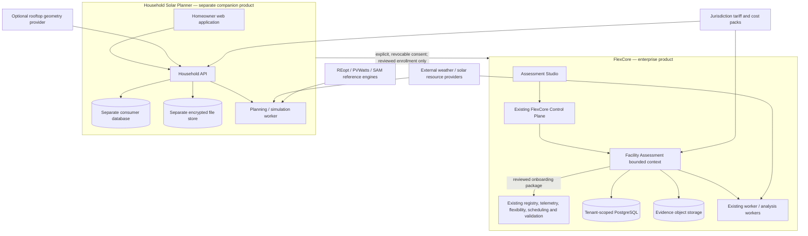
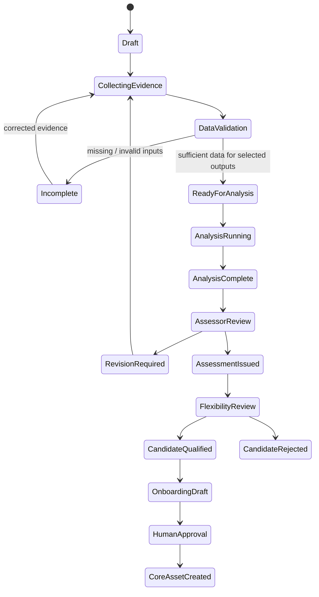

# Neryva Energy Extensions
## Principal Engineering System Design

**Status:** Proposed architecture for design review; not approved for implementation  
**Research cut-off:** 21 November 2026  
**Repository examined:** `Luke23-45/energy-flexcore`, default branch `main`  
**Design scope:** F-16 Facility DER Assessment & Flexibility Qualification; F-17 Household Solar & Storage Feasibility Planner

---

## 0. Executive decisions

This design covers two related but different products. They share energy-domain knowledge, not a single user experience, identity model, database, or control plane.

| Decision | Proposed disposition |
|---|---|
| F-16 Facility DER Assessment & Flexibility Qualification | Add as a new bounded context in the existing FlexCore repository and modular monolith. Use the existing control plane, Postgres/RLS, outbox, worker and core asset/capability contracts. Add a dedicated writable Assessment Studio; do not change the read-only contract of the existing operator console. |
| F-17 Household Solar & Storage Feasibility Planner | Build as a separate companion product and deployment, preferably in its own repository. Give it an independent consumer identity system, database, privacy/retention model and API. It is not a new FlexCore control-plane workspace. |
| Shared code | Do not create a generic shared-energy crate in advance. Share only tested, pure calculations and versioned exchange contracts when a concrete common use case is proven. Do not share tenant-scoped ports or persistence. |
| Optimization | Do not build a second VPP optimizer. F-16 qualifies candidates for the existing FlexCore scheduling pipeline. For F-17, evaluate NREL REopt API v3 / REopt.jl as a sizing-and-dispatch engine and benchmark against SAM; use the existing FlexCore optimizer only after an explicit formulation and provider-capability review. |
| Audit and measurement | Keep the operational append-only audit log, demand-response event M&V, and energy-efficiency savings M&V as three separate concepts. |
| Release | Both are post-v1 proposals. Neither enters the v1.0.0 release gate. Existing build, test, security, license and product-freeze gates remain first. |

### The product boundary

- **F-16 answers:** What does this organization consume? What equipment and energy resources does it have? Which efficiency measures are worth investigating? Which loads or DERs can be credibly qualified for coordinated operation?
- **F-17 answers:** Given a household's location, load, roof, tariff and financial assumptions, is rooftop solar and/or a battery sensible, and how do the credible alternatives compare?
- **FlexCore core answers:** Given already registered assets, trustworthy telemetry, known capabilities and operating constraints, what schedules are feasible and which approved operating actions may be proposed?

An assessment is not an asset. A discovered flexible load is not a qualified dispatch resource. A solar estimate is not an interconnection approval. An optimizer result is not authorization to control a device.

---

## 1. Repository baseline and engineering constraints

The design was checked against the public source tree and the current README, product report, domain contracts, migrations, application modules and worker contracts.

### 1.1 Existing foundations to reuse

| Existing area | Current design / code seam | Extension rule |
|---|---|---|
| Ownership | `Tenant → Portfolio → Site → Asset` in `crates/flexcore-domain/src/entities.rs`; tenant is derived through parent constructors | F-16 tenant-owned records must use the same structural tenancy discipline. A building/facility is not automatically a `Site`. |
| Site and asset schema | `crates/flexcore-domain/src/entities.rs`; Postgres migrations `0003_portfolios`, `0004_sites`, `0005_assets` | Do not add building-inspection or household fields to `Site` or `Asset`. Existing asset type vocabulary is closed by schema checks. |
| Capability | `crates/flexcore-contracts/src/capability.rs`, schema v1 | Treat as a versioned operational contract. No silent field additions. Only publish candidate capabilities that can be represented and validated by the supported schema. |
| Units | `crates/flexcore-contracts/src/units.rs` | FlexCore boundary uses MW, MVAr, MVA and MWh; SOC is a fraction. Convert kW/kWh at adapters. |
| Data quality | `crates/flexcore-contracts/src/quality.rs` | Every measurement retains one of GOOD, SUSPECT, BAD, MISSING, ESTIMATED, STALE. Model uncertainty and source provenance are separate dimensions. |
| Flexible loads | `crates/flexcore-domain/src/flexible_load_model.rs` | The current model has baseline, reducible/increasable range, duration, recovery, rebound, availability and descriptors for comfort/process constraints. It is not a calibrated building thermal simulator. |
| Thermal/efficiency records | `crates/flexcore-application/src/calibrated_model_records.rs` (P15.14) | It can store declared parameters with provenance and checkable arithmetic; it explicitly does not perform model fitting or calibration. Do not call declared records calibrated models. |
| BESS | `crates/flexcore-domain/src/bess_model.rs` | Reuse battery capability rules where the source data is adequate. Unknown limits must not create flexibility credit. |
| Weather | `crates/flexcore-ports/src/weather_data.rs`; `forecast_pv.rs` | A vendor-neutral, tenant-scoped weather seam already exists, but it has no real provider adapter. It is appropriate for F-16; it is not directly reusable by F-17's independent consumer identity boundary. |
| Forecasts | `forecast_architecture.rs`, `forecast_pv.rs`, `forecast_baselines.rs`, P15 records | Forecasts are data inputs, not commands. The PV model declarations are UNTRAINED and unevaluated; no accuracy claims. |
| Optimization | `crates/flexcore-optimization-api` | Solver-neutral problem IR and provider capability declarations already exist. Use only with an explicit supported formulation; unsupported classes must refuse. |
| DR baseline/M&V | `baseline_engine.rs` (P16.04), `mv_event_report.rs` (P16.05) | These are program-configured demand-response baselines and event reports, not whole-building efficiency baselines or retrofit savings verification. |
| Operational audit | `crates/flexcore-audit` | Remains append-only operational evidence. Do not rename or repurpose it as the energy-audit domain. |
| Workers | `python/workers/contracts/worker_api.proto`, `apps/worker` | Use the established out-of-process worker envelope, provenance, idempotency and supervisor pattern for long-running analysis. Worker results remain proposals/data, never commands. |
| API and tenancy | `apps/control-plane`, `crates/flexcore-authz`, `crates/adapters/postgres` | F-16 uses existing control-plane identity, explicit permissions, unit-of-work transactions and forced RLS. F-17 must not be inserted into this tenancy model. |
| Operator UI | `console/README.md` says all console API calls are GET/read-only | Preserve this property. Add a dedicated writable Assessment Studio; optionally show read-only assessment outputs in the operator console later. |

### 1.2 Material repository-document inconsistency

The current root `README.md` describes 29 Cargo workspace members and an implemented source tree that is WRITTEN-UNRUN. The current `AGENTS.md`, however, says the repository is documentation-only and contains no application code, while later sections of that same file describe a release ladder and Rust engineering rules. These statements conflict with the current README and the source tree.

This is a documentation-governance defect, not a product feature. Before this design becomes the repository's authoritative baseline, reconcile `AGENTS.md` with the actual branch state and document hierarchy. Do not let coding agents rely on the stale “documentation only” statement or silently choose which repository state is authoritative.

### 1.3 Current engineering state remains a gate

The README records that the existing workspace has not been compiled, tested or run as a whole; the first human `cargo build --workspace`, then test/clippy and console checks, remain release gates. The README also records that no repository license has been selected and the D4 license/dependency audit remains open. The Phase 0 decision register leaves target jurisdiction/market and first portfolio/service open.

Consequently:

1. Do not implement F-16/F-17 as part of the existing v1.0.0 gate.
2. Resolve and record the current v1 build/test findings before sizing the extension work.
3. Close the license decision before selecting libraries, schemas, datasets or embedded engines for publication/distribution.
4. Select the first F-16 pilot portfolio and jurisdiction before building a tariff pack or a compliance-oriented report.

---

## 2. Product and deployment architecture

### 2.1 Logical architecture



### 2.2 Product boundary decisions

**F-16 stays in the FlexCore repository and control-plane deployment initially.** It is a new bounded context, not a new optimizer or independent microservice. Its evidence parsing and numerical work are asynchronous jobs, but the domain workflows and authorization remain in the existing control plane. This keeps transactional state, tenant RLS, outbox events and the asset-onboarding boundary together.

**F-17 is a separate application and deployment.** It has a different principal (a homeowner), personal data, consent and deletion obligations, product cadence, usage profile and likely public traffic pattern. It must not create an anonymous FlexCore tenant, connect to FlexCore's database, or receive any dispatch permission. I recommend a separate repository as well, because the household planner is a distinct product rather than a FlexCore operator surface. It can later exchange a narrowly scoped, versioned enrollment package with a VPP aggregator after the homeowner explicitly agrees.

### 2.3 No premature shared library

The two products may share knowledge and eventually a few pure calculations, but they do not have the same domain model:

- A commercial facility assessment needs a building/facility hierarchy, energy boundaries, utility account statements, equipment audits, measures and professional review.
- A household planner needs consumer property profiles, roof planes, personal bills, household tariffs, scenario comparison and consent controls.
- FlexCore's asset capability model describes an operational resource at a site/PCC, not a building or a roof.

Do not create a broad `energy-core` crate now. If both applications later use the same tested calculation with the same semantics, extract only that pure code into a versioned, dependency-light library. No persistence, identity, tenant context, network access, credentials or dispatch authority belongs in it.

---

# Part I — F-16 Facility DER Assessment & Flexibility Qualification

## 3. Product scope and first target

### 3.1 Product statement

F-16 is a tenant-scoped assessment and resource-onboarding workflow for commercial and industrial facilities. It collects evidence about a facility's energy use, physical buildings, meters, equipment and operating constraints; derives a transparent energy profile and a shortlist of efficiency opportunities; then identifies candidate resources that may be qualified for existing FlexCore orchestration.

It is **not** initially:

- a replacement for an independent engineering auditor;
- an automatic ASHRAE certification or Level 1/2/3 sign-off engine;
- a complete ISO 50001 energy-management information system;
- a replacement for an existing BMS/EMS/SCADA;
- a new demand-response baseline engine;
- a new VPP optimizer; or
- a substitute for site commissioning, interconnection approval, OT/security review or device safety controls.

### 3.2 First customer archetype

Start with one narrow archetype: a multi-building or single-building commercial facility with an electricity account, one or more meters, HVAC, and possibly rooftop PV, BESS and EV charging. Choose one real pilot jurisdiction and one real facility/operator workflow before implementation.

Do not start with arbitrary manufacturing-process optimization. Industrial processes can have highly specific production, quality, thermal, safety and rebound constraints that the current general flexible-load model does not implement. Add process-specific templates only after a qualified engineering partner and measured data exist.

### 3.3 Initial user roles

Use least-privilege actions, not one broad “auditor can do everything” role:

- **Facility manager:** starts an assessment, supplies bills and equipment information, reviews data mappings and recommendations.
- **Energy assessor:** records inspections and observations, validates the facility and equipment inventory, prepares the assessment report.
- **Flexibility reviewer / power-systems engineer:** reviews flexibility candidates, operational constraints and evidence; accepts or rejects qualification.
- **Tenant operator / administrator:** manages tenant permissions and approves the final creation/linking of Core sites/assets where authorized.
- **Viewer:** reads assessment results and evidence allowed by tenant policy.

These are proposed permission profiles. Map them to the current FlexCore authorization model through explicit action grants; do not assume a new global role enum is already available.

---

## 4. F-16 domain model

### 4.1 Critical modeling distinction: Facility is not Site

The existing FlexCore `Site` is an electrical/operational boundary with a PCC, timezone and grid-model reference. A commercial property may have several buildings, utility accounts and meters. One facility may map to multiple electrical sites, and one electrical site may serve more than one building or tenant area.

Therefore model a separate physical and assessment hierarchy:

```text
Tenant
  └── Facility
       ├── Building (0..n)
       │    ├── BuildingSystem (HVAC, lighting, refrigeration, process, etc.)
       │    │    └── EquipmentItem (0..n)
       │    └── InspectionObservation (0..n)
       ├── EnergyBoundary (1..n)
       │    ├── MeterPoint (1..n)
       │    ├── UtilityAccountReference (0..n)
       │    └── Core Site / SiteMeter Asset references (0..n)
       └── FacilityAssessment (1..n, versioned assessments)
            ├── EvidenceRecord (0..n)
            ├── BillStatement / MeterDataset (0..n)
            ├── AssessmentRun (0..n)
            ├── EnergyConservationMeasureScenario (0..n)
            └── FlexibilityCandidate (0..n)
                  └── AssetOnboardingDraft (0..n)
```

`Facility`, `Building`, `EnergyBoundary`, `MeterPoint`, `EquipmentItem` and FlexCore `Asset` must not be treated as synonyms. An `EquipmentItem` can be recorded for audit purposes without being a grid resource or a dispatchable asset.

### 4.2 Proposed aggregates and records

| Aggregate / record | Key content | Important invariants |
|---|---|---|
| `Facility` | Tenant, name, address/location reference, sector, operating calendar, parent organization reference | Tenant is derived structurally; sensitive address fields have restricted access. |
| `Building` | Facility, use type, gross floor area + unit, construction period, floors, envelope attributes, conditioned area, occupancy/operating profile | Each value carries source/provenance and units; missing values remain missing. |
| `EnergyBoundary` | Facility/building scope, utility account pseudonymous reference, fuel/commodity, import/export direction, meter mapping, effective dates | Defines what consumption and savings mean. Multiple meters are allowed. No assumption that a whole-facility bill maps to one Core Site. |
| `MeterPoint` | Meter identifier/token, meter type, direction, interval cadence, timezone/source, mapped Core SiteMeter reference if available | Raw account identifiers are not exposed in normal DTOs/logs. |
| `UtilityBill` | Statement period, import/export energy, billed demand, tariff reference, itemized charge components, currency, taxes/adjustments, source evidence | A bill is a billing-period financial record, not a telemetry row. Currency is explicit. |
| `MeterDataset` | Measurement boundary, interval series, timestamps, quantity, unit, source, quality, timezone, completeness | Raw and normalized forms remain linked. DST ambiguity, duplicate/missing intervals and data gaps are explicit. |
| `EquipmentItem` | Building/system, equipment category, manufacturer/model, nameplate ratings, install date, operating schedule, evidence | Inspection record does not imply FlexCore asset qualification. |
| `InspectionObservation` | Observation type, value/text, observed date, assessor, evidence references, confidence, follow-up | User-declared, assessor-observed and instrument-measured evidence are distinct. |
| `EnergyConservationMeasure` (ECM) | Measure identity/version, affected system/end use, applicability, prerequisites, cost basis, savings method, lifetime, O&M, source, region | Catalog entry is versioned and sourced; applicability is checked; no universal savings percentage. |
| `MeasureScenario` | One or more ECMs, baseline snapshot, interactions, costs, expected savings range, cashflow assumptions | Scenario is immutable once run; interacting ECMs are not naively summed. |
| `AssessmentRun` | Assessment revision, input snapshot/digests, model versions, weather/tariff/catalog versions, warnings, output references, engine version | Immutable calculation record; re-run creates a new ID. |
| `FlexibilityCandidate` | Candidate equipment/load, service window, response/ramp, duration, rebound/recovery, limits, data source, confidence, missing evidence, reviewer | Candidate lifecycle is separate from Core asset lifecycle and dispatch authority. |
| `QualificationDecision` | Reviewer, evidence snapshot, rule-set version, accepted/rejected/conditional result, scope/expiry, reason | Human sign-off and expiry are explicit. |
| `AssetOnboardingDraft` | Candidate, target Core Site, proposed AssetType, proposed capability schema/version, mapping, review status | Draft has no control effect. Only an authorized approval creates/links Core asset/capability records. |
| `EfficiencySavingsVerification` | ECM, measurement boundary, baseline/reporting periods, adjustment records, meter references, M&V plan, results | Separate from P16 demand-response event M&V. Method and evidence are versioned. |

### 4.3 Data provenance is multidimensional

Do not collapse data trust into a single `confidence` or `quality` badge. Every important value should retain at least:

1. **Source kind:** utility-issued statement, calibrated meter, BMS export, equipment nameplate, assessor observation, owner declaration, public weather feed, commercial data provider, model-derived value.
2. **Source reference:** document/file/version, meter/provider ID, observation record or external dataset reference.
3. **Measurement quality:** one of FlexCore's six canonical telemetry quality states where the record is measurement-like.
4. **Model uncertainty:** range/distribution or explicit unknown; do not pretend a quality flag is a statistical confidence interval.
5. **Verification state:** unreviewed, source-validated, assessor-reviewed, engineering-reviewed, expired or rejected.
6. **Time validity:** when the fact was true, when it was received, and when it expires or must be revalidated.

Unknown constraints must not widen a feasible range or earn positive dispatch credit. This preserves the existing P3.02 unknown-narrows rule.

---

## 5. F-16 workflows and calculations

### 5.1 End-to-end assessment lifecycle



The assessment can be issued without any flexibility candidates. An energy report does not require a candidate to be dispatchable. Conversely, a resource can be inventoried before a complete whole-building efficiency study exists if the necessary equipment and telemetry evidence is available.

### 5.2 Evidence ingestion pipeline

1. Create an upload intent with tenant, assessment, file type, declared period, size limit and checksum expectation.
2. Issue a short-lived signed upload URL to a private evidence bucket; never proxy very large files through the control-plane memory path.
3. Finalize upload and verify size, checksum, MIME signature and ownership.
4. Quarantine and malware-scan the file; parse it in a restricted worker process.
5. For BuildingSync XML, validate against the pinned XSD and applicable Schematron use case. Disable DTDs/external entities and bound expansion, recursion, archive extraction and parser resources.
6. Produce a normalized staging record plus row/cell/XPath-level errors. Do not write questionable rows directly into authoritative telemetry or bills.
7. Let an authorized user review the mapping, period, units, direction and meter/boundary association.
8. Commit accepted records and audit references transactionally; preserve the original evidence object and content hash.

Bill PDFs, invoices and BuildingSync files are not telemetry. Keep `UtilityBill` and `MeterDataset` separate. Interval samples may later be mapped into Core `SiteMeter` telemetry only when the source, measurement semantics, quantity, unit, time and quality match the telemetry contract.

### 5.3 Energy baseline and consumption analysis

The baseline service must answer: which period, boundary, fuels, meters, adjustments and model produced the baseline?

Minimum design:

- reconcile bills against interval meter totals where both exist;
- preserve import and export separately;
- distinguish gross facility load, onsite generation, storage charge/discharge, grid import and grid export where evidence supports them;
- calculate monthly totals and demand peaks from the actual tariff/billing window;
- support weather normalization only when weather, measurement periods and relevant operating variables are available;
- retain production, occupancy, operating hours, expansions, closures and other non-routine changes as explicit adjustment records;
- return data completeness, missing intervals, meter coverage and model diagnostics;
- produce a range or a data-readiness refusal where the evidence cannot support a normalized baseline.

Twelve months of bills is a reasonable initial target for seasonality coverage, not a universal guarantee of an accurate baseline. Higher-frequency meter data and operating context are required for more detailed load analysis. A bill-derived monthly profile must not be presented as an hourly load curve.

P15.02's degree-day regression is a forecasting baseline design with its own declared inputs and no evaluated skill claim. It may be a reference for a separately specified weather-normalization method, but it is not itself proof of a compliant whole-building baseline or savings result.

### 5.4 Efficiency measures and economics

Start with a small, curated ECM catalog for the selected pilot archetype, not an open-ended recommendation engine. Example measure families might include lighting controls, HVAC scheduling/controls, equipment replacement, compressed-air leak work, envelope improvement, onsite PV and storage. Each catalog entry must be backed by a traceable source or a named engineering assumption.

Each measure definition must hold:

- technology/category and applicability conditions;
- affected system and end-use boundary;
- required survey fields and evidence;
- prerequisites and exclusion conditions;
- savings calculation method and its version;
- low/base/high input assumptions where justified;
- installed-cost source, currency, region and validity date;
- useful life, maintenance and replacement assumptions;
- interactions with other measures;
- model limitations and verification requirements.

Do not add measure savings linearly when measures interact. For example, lighting changes can alter cooling/heating loads; HVAC controls alter load profiles and peak demand; PV and batteries interact with tariff and export rules. Model bundled scenarios explicitly or label interaction effects as unmodeled.

Economics should calculate simple payback only as a secondary indicator. For investment comparisons, use a versioned cashflow model with NPV, discount-rate basis, energy-price escalation, O&M, replacement, tax/incentive treatment and finance terms. Do not publish an ROI result when the tariff or local installed-cost data are unsupported.

### 5.5 Flexibility discovery and qualification

Discovery is a staged evidence process, not a boolean field on `EquipmentItem`.

Suggested candidate lifecycle:

`DISCOVERED → EVIDENCE_INCOMPLETE → ENGINEERING_REVIEW → QUALIFIED | REJECTED → ONBOARDING_DRAFT → APPROVED_AND_ONBOARDED`

Add `EXPIRED` or `SUSPENDED` when the qualification evidence or operating configuration is no longer valid.

Qualification checklist by resource:

| Dimension | Required evidence / decision |
|---|---|
| Physical identity | Equipment make/model, rated power/energy, equipment boundary, electrical connection, ownership/operator |
| Electrical mapping | Core Site/PCC, phase, grid-model/bus reference, connection topology where required |
| Controllability | Local controller/BMS/BAS/EMS interface, command path, supported setpoint/mode, control permission and safe local fallback |
| Capability | Import/export limits, ramp, operating mode, power/energy window, response delay, duration, availability, recovery and rebound |
| Operating constraints | Comfort/process/service limits, maintenance windows, opt-out, safety and local override rules |
| Measurement | Appropriate meter point, cadence, clock quality, measurement quality and baseline evidence |
| Network and site limits | PCC and transformer/import/export constraints; network feasibility remains a separate Core validation gate |
| Governance | Engineering reviewer, scope, expiry/review period, evidence snapshot and approval record |

A manual inspection can identify a candidate. It cannot by itself prove dispatchability. A load with only a declared thermal time constant and no measured calibration is not promoted as a validated thermal asset. The existing P15.14 `DeclaredThermalModel` can record sourced parameters; it does not fit or calibrate a physical model.

### 5.6 Safe mapping into existing FlexCore assets

F-16 should map, not redefine, the Core capability vocabulary:

| Assessment object | Potential Core mapping | Qualification caveat |
|---|---|---|
| Rooftop PV plant | Existing `PvInverter` asset(s) | Inverter AC limits and site connection must be evidenced; PV module nameplate alone is not dispatch capability. |
| Battery energy storage | Existing `Bess` asset | Requires BMS limits, SOC/energy window, efficiency, reserve and operating constraints with provenance. |
| HVAC / flexible facility load | `FlexibleCiLoad` or `ThermalStorageHeatPump` where supported | Numeric comfort/thermal dynamics must be supported by the capability model and site integration; a descriptor alone is not enough for automated dispatch. |
| EV charging | Existing `EvseEvFleet` asset | Charger capability, vehicle connection/departure and charging requirements are needed. |
| Site meter | Existing `SiteMeter` asset | Map only normalized interval values whose quality/time/unit and measurement boundary are compatible. |

No “building”, “roof”, “chiller” or “solar panel” asset type should be injected into the existing closed AssetType enum. If a genuinely new resource class is needed, write a schema-versioned design decision and additive migration with compatibility tests.

An onboarding draft is only a proposal. An authorized operator approves it; the Core registry creates the Asset and CapabilityModel through existing use cases and transactional boundaries. Candidate qualification does not grant dispatch authority.

---

## 6. F-16 architecture and repository placement

### 6.1 Keep the existing modular monolith

Do not create a microservice for every assessment concept. The domain, application workflows and authoritative metadata belong in the existing FlexCore layers. Long-running file parsing and numerical analysis use the existing worker/supervisor boundary.

Proposed placement (illustrative module names; create only with real implementation):

```text
crates/
  flexcore-domain/src/
    facility/                 # Facility, Building, EnergyBoundary, Equipment
    facility_assessment/      # Assessment, Bill, Dataset, ECM, Candidate states
  flexcore-application/src/
    facility_assessment/      # use cases and pure calculations/orchestration
    efficiency_savings/       # separate from DR event M&V
  flexcore-ports/src/
    facility_assessment/      # tenant-scoped repositories / import / evidence seams
    building_data_exchange/   # BuildingSync provider-neutral boundary
    tariff_data/              # versioned tariff pack access
  adapters/postgres/
    migrations/               # tenant-owned assessment tables, RLS and indexes
    src/                      # repositories and transactional adapter mapping
apps/
  control-plane/src/
    routes_facility_assessment.rs
    dto_facility_assessment.rs
  worker/                     # existing job supervision and consumers
  facility-assessment-studio/ # new writable React/TypeScript surface
```

Do not create empty crates. Reuse `flexcore-domain`, `flexcore-application`, `flexcore-ports`, Postgres adapter, control-plane and worker until an independent deployment or dependency boundary is demonstrated.

### 6.2 API surface

All tenant-owned operations derive the tenant from authenticated `TenantContext`, authorize an explicit action and execute inside a unit of work. Cross-tenant reads return indistinguishable not-found outcomes. Upload and analysis are idempotent and bounded.

Proposed routes:

| Route | Purpose |
|---|---|
| `POST /api/v1/facility-assessments` | Create draft assessment and bind facility/scope |
| `GET /api/v1/facility-assessments/{id}` | Read assessment status and summary |
| `POST /api/v1/facility-assessments/{id}/uploads` | Create evidence upload intent |
| `POST /api/v1/facility-assessments/{id}/bills` | Register parsed/reviewed utility bill record |
| `POST /api/v1/facility-assessments/{id}/meter-imports` | Start interval data import job |
| `POST /api/v1/facility-assessments/{id}/buildingsync-imports` | Validate and stage BuildingSync XML |
| `POST /api/v1/facility-assessments/{id}/equipment-observations` | Record or update a versioned inspection observation |
| `POST /api/v1/facility-assessments/{id}/analysis-runs` | Start immutable baseline/measure analysis |
| `GET /api/v1/facility-assessments/{id}/analysis-runs/{run_id}` | Read result, warnings and provenance |
| `POST /api/v1/facility-assessments/{id}/flexibility-candidates/{candidate_id}/review` | Record human qualification review |
| `POST /api/v1/facility-assessments/{id}/asset-onboarding-drafts` | Propose mapping to existing Core Site/Asset |
| `POST /api/v1/asset-onboarding-drafts/{id}/approve` | Authorized approval through Core use cases |

Use explicit action grants such as `assessment.create`, `assessment.read`, `assessment.evidence.upload`, `assessment.run`, `flexibility_candidate.review`, `asset_onboarding.propose` and `asset_onboarding.approve`. These are proposed permission names, not existing grants.

### 6.3 Events and asynchronous work

Publish state-change events using the existing transactional outbox discipline. Examples:

- `FacilityAssessmentCreated`
- `AssessmentEvidenceAccepted` / `AssessmentEvidenceRejected`
- `MeterDatasetImported` / `MeterDatasetImportFailed`
- `AssessmentAnalysisCompleted`
- `MeasureScenarioEvaluated`
- `FlexibilityCandidateDiscovered`
- `FlexibilityQualificationRecorded`
- `AssetOnboardingDraftApproved`

Long-running analysis requests carry a request ID, idempotency key, input snapshot ID/digest, schema version, engine version, model/provider version and declared determinism metadata. The worker returns a result envelope and diagnostics; it cannot create or issue a dispatch command.

### 6.4 Persistence and object storage

- Store queryable domain state, versions, references and audit metadata in PostgreSQL.
- Store raw bills, reports, photos, BuildingSync XML and large meter files in a private object store. Save object key, content hash, source, MIME, uploader, ingestion result and retention class in PostgreSQL.
- Enable and FORCE RLS for every tenant-owned table; composite tenant foreign keys should prevent cross-tenant parent-child references.
- Keep original evidence immutable. Corrections create new records linked to the previous record rather than overwriting source evidence.
- Store normalized datasets separately from raw objects, with an import-run version and a reversible mapping to source rows/cells.
- Retention, export and deletion behavior must be data-class-specific and explicit. Do not infer a default from an unset retention policy.
- Use existing transaction + outbox atomicity for authoritative changes and event publication.

---

## 7. F-16 standards and interoperability

### 7.1 BuildingSync

BuildingSync is the preferred first interoperability target for commercial building assessment data. The project publishes v2.7.0 and an XML schema, data dictionary, measures and use-case validation resources. DOE describes it as a BEDES-compliant XML schema for building audit data, supporting ASHRAE Levels I, II and III and energy-efficiency measures.

Important boundary: BuildingSync standardizes the exchange structure and terminology; it does not standardize the calculations performed by the software. Therefore:

- define a FlexCore-specific BuildingSync use case/model view;
- build import/export mapping against the pinned v2.7.0 XSD and a selected Schematron use case;
- round-trip representative sample files in automated tests;
- preserve unknown extension elements or report them as unmapped rather than silently discarding them;
- keep the internal domain model independent of the XML schema;
- do not claim “BuildingSync-certified” unless the relevant program actually grants such status.

Primary sources: [BuildingSync releases](https://buildingsync.net/releases), [DOE BuildingSync overview](https://www.energy.gov/cmei/buildings/buildingsync), [BuildingSync auditor workflows](https://buildingsync.net/auditors), [validation resources](https://buildingsync.net/technical_resources).

### 7.2 ASHRAE Standard 211

ASHRAE Standard 211 (2018, reaffirmed 2023) and Addendum a provide the commercial-building energy audit / decarbonization-assessment framework. Its stated scope excludes single-family houses, multifamily buildings of three stories or fewer, and manufactured/mobile/modular homes. This reinforces that F-16 is the commercial assessment context and F-17 is not an ASHRAE 211 home-audit engine.

The software may support evidence collection and report structuring that an appropriately qualified professional uses. It must not claim conformance from the mere presence of a checklist or BuildingSync export. Obtain the current licensed standard and qualified engineering review before implementing any standard-specific normative workflow or making conformance claims.

Primary sources: [ASHRAE Titles, Purposes and Scopes](https://www.ashrae.org/technical-resources/standards-and-guidelines/titles-purposes-and-scopes), [Addendum a to Standard 211](https://www.ashrae.org/file%20library/technical%20resources/standards%20and%20guidelines/standards%20addenda/211_2018_ra2023_a_20241030.pdf).

### 7.3 Efficiency savings verification vs demand-response M&V

The existing P16.04/P16.05 workflow measures demand-response program baselines and event delivery. F-16's post-retrofit efficiency savings workflow has a different boundary and purpose.

Create a separate `EfficiencySavingsVerification` context, with:

- the affected system or whole-facility measurement boundary;
- baseline and reporting periods;
- meter coverage and fuel types;
- weather, production, occupancy and operating-condition adjustments;
- non-routine adjustment records;
- M&V plan version and chosen method;
- data exclusions and uncertainty;
- independent reviewer and report status.

IPMVP Core Concepts 2022 is the relevant reference framework for energy-efficiency, renewable-energy and water savings verification. EVO explains that savings are not directly measured; they are determined by comparing measured baseline and reporting-period consumption/demand on a consistent basis, with suitable adjustments. The full 2022 document is accessed through EVO's member library. Acquire the current licensed copy and practitioner review before implementing protocol-specific details; do not reproduce licensed tables/formulas from summaries.

Primary sources: [EVO IPMVP page](https://evo-world.org/en/products-services-mainmenu-en/protocols/ipmvp), [IPMVP documents](https://evo-world.org/en/library/download-protocol-documents-mainmenu-en).

---

# Part II — F-17 Household Solar & Storage Feasibility Planner

## 8. Product scope

### 8.1 Product statement

F-17 is a consumer-facing decision-support application that compares grid-only, solar-only and solar-plus-storage options for an individual household. It helps a person understand physical feasibility, expected generation, self-consumption, import/export behavior, financial sensitivity and the next steps needed for a site-specific quotation or inspection.

It is not a whole-house professional energy audit, installer marketplace, lender, official interconnection portal, or remote home-energy controller.

### 8.2 Core user journey

1. **Property and location:** enter country/utility area and an address or approximate coordinates. Explain why precise address is needed if a roof imagery provider is called. Offer a manual location fallback.
2. **Electricity usage:** upload bills or enter monthly consumption. Where available, import interval data through a supported utility consent mechanism or user-uploaded CSV.
3. **Tariff:** identify the correct utility, customer class, import tariff, export credit/net-billing method, TOU periods, fixed charges and relevant taxes.
4. **Roof:** retrieve optional roof-plane data from a provider if coverage/quality is adequate; otherwise let the user draw/declare roof planes and obstructions. Show source and imagery age.
5. **Equipment and constraints:** select candidate PV module/inverter assumptions and battery options. Keep generic assumptions visibly separate from actual vendor quotations.
6. **Compare scenarios:** grid only, PV at several candidate sizes, PV + battery with multiple capacities/power ratings, and optionally battery-only where appropriate.
7. **Review outputs:** compare expected generation, self-consumption, imports, exports, bill cost, lifecycle cashflow, uncertainty and missing information.
8. **Decision package:** produce a downloadable report for the homeowner to discuss with an installer. It should be able to recommend “do not install” or “collect more data” when evidence is insufficient.
9. **Optional sharing:** a separate, explicit consent lets the homeowner send a chosen project package to a named installer or aggregator. No silent transfer to FlexCore.

### 8.3 Initial non-goals

- 3D design and installer sales workflows comparable to OpenSolar or Aurora;
- installer marketplace or lead resale;
- automated roof structural adequacy certification;
- automatic permit/interconnection filing;
- financing underwriting or a loan marketplace;
- automatic equipment procurement;
- residential dispatch/control;
- a generic home energy audit that claims to assess insulation, ventilation, combustion safety and building condition from bills alone.

---

## 9. F-17 domain model

| Record | Key fields | Design rule |
|---|---|---|
| `HomePlan` | Consumer identity, project label, country/jurisdiction, lifecycle, creation date | Separate consumer root; no FlexCore tenant ID. |
| `PropertyProfile` | Address (separately protected), coordinates, property type, timezone, occupancy assumptions | Exact address PII has a stricter access/logging policy than coarse coordinates. |
| `RoofPlane` | Geometry/area, azimuth, tilt, usable area, obstruction/shading descriptors, source/provider, imagery quality/date | Every roof value is provider-derived, user-declared or site-verified; never silently combine them. |
| `LoadProfile` | Monthly bills and/or interval series, meter source, time zone, interval duration, import/export, quality, completeness | Bill-only and interval-measured profiles are separate quality tiers. No invented hourly profile masquerading as measurement. |
| `TariffProfile` | Utility, customer class, currency, import rate, export compensation, TOU schedule, tiers, fixed charges, demand charges, minimum bill, taxes, net-metering/net-billing rules, valid dates, source | Versioned by jurisdiction and effective dates. Unsupported tariff features cause a named limitation/refusal. |
| `PVSystemScenario` | DC size, inverter AC size, module/array assumptions, tilt, azimuth, losses, degradation, optional bifacial/soiling parameters | Engine/provider inputs and model version are retained with every run. |
| `BatteryScenario` | Usable energy, power, chemistry, round-trip efficiency, SOC range, reserve, warranty/degradation and replacement assumptions | Separate usable capacity from nameplate capacity; no battery-only scenario without an appropriate tariff/use case. |
| `FinancialAssumptionSet` | Installed cost, itemized CAPEX, O&M, replacement, discount rate, escalation, incentives, taxes, financing | Every cost/incentive has jurisdiction, currency, source and date. User-entered quote overrides a generic estimate but is labelled. |
| `ScenarioRun` | Immutable input snapshot, tariff/weather/roof/engine/model versions, solver status, output digest, warnings and uncertainty | One run = one fixed set of inputs. Editing any assumption creates a new run. |
| `ConsentGrant` | Purpose, recipient, fields, expiry, revocation status and created-at | Sharing is specific, revocable, logged and separate from general terms of service. |

### 9.1 Input quality tiers

The application must explicitly report which evidence tier a recommendation used:

- **Tier A — interval measured:** utility or meter-provided hourly/15-minute data with documented quality. Suitable for much stronger self-consumption and battery dispatch analysis, subject to data coverage and tariff correctness.
- **Tier B — monthly measured:** actual monthly bills and consumption values. Suitable for annual/monthly solar-yield comparisons and a coarse bill model; not sufficient to claim precise hourly battery dispatch optimization.
- **Tier C — household-declared:** appliance list, schedules or representative daily profiles supplied by the user. Useful for indicative scenarios; explicitly estimated.
- **Tier D — default assumption:** generic profile or equipment assumptions. Use only when requested, show them prominently and widen uncertainty. Never label as measured.

If only monthly consumption is available, the planner can estimate PV production and compare broad solar-only scenarios. It must not report a precise battery size, hourly self-consumption, peak-shaving savings or optimized dispatch result as though interval data existed.

---

## 10. F-17 calculation architecture

### 10.1 Roof and solar resource

Define provider-neutral seams:

- `RoofGeometryProvider`: building footprint, roof planes, dimensions, imagery/model quality and source timestamp.
- `SolarResourceProvider`: weather/climate station, solar irradiance, temperature, wind and time-series resource with dataset version.
- `PVYieldProvider`: takes normalized location, roof-plane and system inputs; returns monthly/annual or interval AC/DC production, losses, station/dataset details, warnings and model version.

Google Solar API can be an optional `RoofGeometryProvider` implementation. Its `buildingInsights`, `dataLayers` and `geoTiff` endpoints can provide building/roof and solar-potential information. Coverage is country-specific; imagery quality is HIGH/MEDIUM/BASE, and Google notes that its coverage map is approximate and some requests near coverage boundaries return 404. Therefore provide manual roof-plane entry and an explicit “roof assessment unavailable” path. Do not make Google Solar a mandatory system dependency.

For PV yield, NLR PVWatts V8 is a strong first benchmark/provider candidate. It accepts nameplate capacity in kW and can return monthly/annual energy in kWh or hourly AC output in W; its response includes warnings, service version and weather-station metadata including station distance and source. The adapter must record these fields and convert units explicitly. PVWatts uses TMY weather inputs for the covered datasets; it is not a guaranteed roof-specific forecast and should not be described as one.

PVGIS can be evaluated as a second independent provider, but pin a production API version and test version compatibility before use. Do not silently switch a production run to a beta API because the endpoint or dataset changed.

Provider sources:
- [PVWatts V8 API](https://developer.nlr.gov/docs/solar/pvwatts/v8/)
- [NLR Solar API overview](https://developer.nlr.gov/docs/solar/pvwatts/)
- [Google Solar API overview](https://developers.google.com/maps/documentation/solar/overview)
- [Google Solar API coverage](https://developers.google.com/maps/documentation/solar/coverage)
- [Google Solar API methodology and limitations](https://developers.google.com/maps/documentation/solar/methodology)

### 10.2 Solar production is not bill savings

The system must separate three computations:

1. **PV production:** expected AC energy by interval/month under an explicitly versioned weather/system model.
2. **Energy balance:** how PV aligns with household consumption, exports, imports and (where modeled) battery charging/discharging.
3. **Bill calculation:** how those flows interact with the customer's actual import tariff, export compensation, fixed charges, demand/TOU components, credits and taxes.

Do not calculate savings as `annual PV kWh × retail price` unless that simplification is demonstrably valid for the tariff and is labelled as such. Under net-billing or low export compensation, exported kWh and self-consumed kWh have different economic value. Battery value depends on interval load, tariff and operating constraints.

### 10.3 Tariff engine

A tariff is executable data with a source and validity period, not one scalar “price per kWh”. The model must represent, where applicable:

- import energy rate by season, month, weekday/weekend and time-of-use window;
- export compensation/net billing/net metering and credit carry-forward/expiry;
- fixed customer charges and minimum monthly bill;
- demand charges and demand windows;
- tiers/block rates;
- taxes, fuel adjustments and other surcharges;
- customer class, utility, voltage/service class and jurisdiction;
- currency and effective dates.

Use a provider-neutral `TariffCatalog` port. OpenEI's URDB is useful for the U.S. and includes international entries in API versions 4+, but its documentation describes most U.S. utility rates; it is not a global source-of-truth. For each launch country, create a reviewed jurisdiction pack using official utility/regulator schedules and source dates. If the tariff includes a feature the calculator does not support, return `UNSUPPORTED_TARIFF_RULE` or require an explicitly simplified scenario; never drop the component silently.

Source: [OpenEI Utility Rate Database API](https://apps.openei.org/services/doc/rest/util_rates/).

### 10.4 Battery and system sizing

Do not build a new optimization engine initially. NREL's REopt API v3 is currently the stable API and uses REopt.jl as its engine; NLR describes REopt as optimizing system sizing and dispatch for buildings, campuses, communities and microgrids. This makes it the leading candidate for an external optimization reference and proof-of-concept adapter. REopt.jl's source repository provides a direct package and its public repository includes an Apache 2.0 license file; still review all transitive dependencies, solvers and API terms before making it a production dependency.

Recommended sequence:

1. Use measured interval load, provider-produced PV intervals and a valid tariff to form a constrained scenario.
2. Run grid-only, PV-only, PV+battery and candidate-size alternatives.
3. Record objective, constraints, engine/solver version, termination, infeasibility/optimality status, runtime, and all assumptions.
4. Expose whether the result is optimal, feasible with a gap, timed out, infeasible or unsupported. Do not call a time-limited incumbent “optimal”.
5. Benchmark selected cases against NREL SAM, which provides residential/commercial financial models and detailed behind-the-meter battery dispatch/degradation capabilities.
6. After the model is understood and user demand is validated, decide whether a local REopt.jl worker is operationally preferable to a hosted API. This is a build-vs-buy/license/operations decision, not a foregone conclusion.

Sources:
- [REopt API v3](https://developer.nlr.gov/docs/energy-optimization/reopt/v3/)
- [REopt overview](https://developer.nlr.gov/docs/energy-optimization/reopt/)
- [REopt.jl repository](https://github.com/NatLabRockies/REopt.jl)
- [REopt.jl license](https://github.com/NatLabRockies/REopt.jl/blob/master/LICENSE)
- [SAM financial models](https://sam.nrel.gov/financial-models.html)
- [SAM battery models](https://sam.nrel.gov/battery-storage.html)

The existing FlexCore `Optimizer` port should only be reused if the chosen home-planning formulation can be faithfully expressed in its problem IR and the selected provider declares support for all needed features. Do not route a nonlinear, mixed-integer or time-series problem into a solver that does not support it. The Core optimizer is designed for the VPP problem classes documented in the current architecture, not automatically for every residential techno-economic case.

### 10.5 Financial model

The baseline comparison should have a common analysis horizon and explicitly versioned inputs:

- installed system cost by component (modules, inverter, battery, mounting, electrical work, permits, labor, taxes);
- O&M and inverter/battery replacement assumptions;
- PV degradation and battery usable-capacity/degradation assumptions from sourced data;
- electricity price escalation and export rate assumptions;
- incentive eligibility, amount and effective dates;
- financing interest/term/down-payment or cash purchase assumptions;
- discount rate (nominal or real, consistently handled);
- taxes and fees if in scope.

Return undiscounted bill savings and discounted cashflow/NPV. Simple payback may be shown as a secondary indicator. IRR is optional and should be omitted when cashflow sign changes make the result ambiguous or non-unique. Provide low/base/high sensitivities only where the input ranges have a credible source; do not invent probability distributions.

A solar-yield estimate without a supported local tariff and installed-cost basis is still useful, but it is a technical potential estimate—not a financial recommendation. Suppress payback/ROI rather than invent the missing inputs.

---

## 11. F-17 service, API and privacy design

### 11.1 Deployment and application layers

```text
household-planner (separate product / repository)
  web/                         React + TypeScript public application
  api/                         independent authenticated API
  domain/                      HomePlan, Property, Roof, Tariff, Scenario
  adapters/
    roof/                      optional Solar API adapter
    solar_resource/            PVWatts/PVGIS/etc. adapters
    tariff/                    jurisdiction tariff packs and data feeds
    optimizer/                 REopt API v3 adapter; future local worker
    storage/                   separate database and private object store
  workers/                     long-running PV/system/financial scenario jobs
```

The initial prototype may be a thin web/API product with provider adapters and a small set of fixed scenarios. Do not build a generalized plugin system, installer CRM or microservice fleet for the first user test.

### 11.2 Proposed API

| Route | Purpose |
|---|---|
| `POST /api/v1/home-plans` | Create a homeowner project |
| `PUT /api/v1/home-plans/{id}/property` | Save property and coarse/precise location with consent |
| `POST /api/v1/home-plans/{id}/usage-imports` | Upload bill/interval data or create a Green Button consent flow where supported |
| `POST /api/v1/home-plans/{id}/roof-assessments` | Request provider roof data or submit manual roof planes |
| `GET /api/v1/tariff-options` | Search available reviewed jurisdiction tariff profiles |
| `POST /api/v1/home-plans/{id}/scenarios` | Save a versioned PV/battery alternative |
| `POST /api/v1/home-plans/{id}/scenario-runs` | Queue an immutable analysis run |
| `GET /api/v1/home-plans/{id}/scenario-runs/{run_id}` | Retrieve outputs, model versions and caveats |
| `POST /api/v1/home-plans/{id}/share-consents` | Grant specific data sharing to a named recipient |
| `DELETE /api/v1/home-plans/{id}/share-consents/{consent_id}` | Revoke future sharing access |
| `DELETE /api/v1/home-plans/{id}` | Start documented deletion workflow subject to legal retention requirements |

### 11.3 Consumer privacy and security

Household address, utility account data, bills, interval energy usage and occupancy assumptions are sensitive personal data. Design for minimization from the beginning:

- separate household database, service credentials, encryption keys and object-store bucket from FlexCore;
- store precise postal address apart from calculation-ready coordinates where feasible; only send minimum required location precision to providers;
- never log utility-account numbers, raw addresses, bill contents, access tokens or signed URLs;
- upload documents to quarantine, scan them and parse in a resource-limited worker;
- use short-lived upload/download URLs, CSRF protection, rate limits, IDOR protection and explicit owner authorization;
- encrypt data at rest and in transit; define deletion, export and backup-expiry behavior;
- do not use household bills, locations or occupancy data for model training or marketing by default;
- require a separate, specific, revocable consent before sharing a report or interval data with an installer, utility or aggregator;
- keep an access/sharing record; consent revocation stops future access and deletes/withdraws derived copies where contractually and technically possible.

F-17 has no direct path to FlexCore dispatch, commands, credentials or site-edge connections.

### 11.4 Green Button and utility-data access

Where a utility supports Green Button Connect My Data, it can provide customer-authorized usage/billing data through the ESPI model. The interval can vary according to the utility's meter data capability (for example, 15-minute, hourly, daily or monthly). This is an optional integration, not a global assumption; manual bill and CSV import remain necessary.

Source: [Green Button Connect My Data](https://greenbuttondata.org/cmd.html).

---

## 12. Interoperability between F-17 and FlexCore

There is no automatic synchronization of home plans into the VPP platform.

When a homeowner explicitly opts into a residential aggregation program:

1. The planner creates a signed, versioned `ResidentialDEREnrollmentPackage` containing only selected fields: customer-chosen site location, equipment records, proposed PV/BESS capabilities, source evidence references/digests, relevant availability/operating constraints and consent metadata.
2. The named aggregator receives the package through a separate integration endpoint.
3. The aggregator verifies customer authorization, equipment ownership, grid/site mapping, interconnection rules, telemetry path and control permissions.
4. A tenant operator reviews and approves creation of the appropriate FlexCore `Site`, `Asset` and capability records inside the aggregator's tenant.
5. Device communications and dispatch remain on the qualified aggregator/site integration path. The household planner never receives field-control credentials.
6. Revocation and contract termination are handled by the aggregator's enrollment/offboarding workflow, with explicit consequences for the Core assets and retained operational records.

Do not make a residential user a FlexCore tenant by default. In a VPP deployment, the aggregator is normally the FlexCore tenant/operator and the household is an external customer/resource owner.

---

## 13. Cross-cutting reliability, model governance and testing

### 13.1 Immutable calculation records

Every analysis result in both products should be reconstructable from a captured input snapshot. Store at minimum:

- input snapshot ID and canonical digest;
- raw-data/document digest references;
- parser/importer version;
- source/provider and API version;
- weather dataset or station ID/distance/quality;
- tariff profile ID/version and effective date;
- ECM catalog or PV/battery model version;
- optimizer/solver version, termination status and gap where relevant;
- assumptions and user overrides;
- data completeness and exclusions;
- uncertainty/limitations and warnings;
- produced-at time and code build/version.

New evidence or changed assumptions create a new immutable run. Do not overwrite a historic recommendation with a newer model result.

### 13.2 Determinism and repeatability

- Use the existing FlexCore worker envelope for F-16 analysis jobs. Carry request ID, idempotency key, schema version, snapshot ID, model/worker version and determinism metadata.
- For numerical providers that are not bitwise deterministic, record tolerances and solver status and test numerical equivalence within documented limits; do not advertise exact replay if the engine cannot provide it.
- Store actual external provider request parameters and provider response digest, with credentials removed.
- Keep model evaluation datasets and hand-calculated reference cases separate from live user data.

### 13.3 Test plan — F-16

**Domain/property tests**
- Facility/building/boundary/meter relationships and tenant parent consistency.
- Bill period/timezone and currency/unit validation.
- Import/export sign and energy reconciliation.
- Interval duplicates, gaps, late arrivals, DST short/long days and ambiguous local timestamps.
- Provenance/quality preservation and unknown-narrows behavior.
- ECM applicability, bundle interaction handling and no silent savings stacking.
- Flexibility qualification state transitions and expiry/revocation.
- Mapping of only supported candidate types to existing AssetType and CapabilityModel v1.

**Format and adapter contract tests**
- BuildingSync v2.7.0 XSD + selected Schematron validation; import/export round trips; unknown fields and invalid documents.
- Utility bill parser fixtures from representative anonymized providers.
- Interval meter imports with source row references and units.
- Object-store upload checksum, malware quarantine, signed URL expiry and tenant-isolation tests.
- Tariff source versions and unsupported-rule refusals.

**Integration/security tests**
- RLS across every new tenant table; no cross-tenant FK or object access.
- Authorization matrix across facility manager, assessor, reviewer, administrator and viewer.
- Outbox atomicity and idempotent worker retry.
- Evidence upload resource limits; XML XXE/entity-expansion tests; archive bomb and malformed CSV tests.
- Assessment data cannot create an Asset until approval.
- No route from an assessment worker to command authorization or dispatch.

### 13.4 Test plan — F-17

- Solar yield benchmark cases for fixed systems across representative latitude, tilt, azimuth and system sizes; compare adapter output against pinned PVWatts V8 reference cases.
- Record station selection, source dataset and station distance; test no-station/large-distance/error cases.
- Roof provider unavailable, low-quality or stale imagery; manual roof-plane fallback.
- Tariff tests for flat, TOU, tiered, net-metered/net-billed and demand-charge tariffs; unsupported tariff rule refusal.
- Bill-only versus interval-data cases; prove that monthly-only inputs never produce claims of measured hourly self-consumption.
- Battery energy balance, SOC bounds, reserve, charge/discharge limits, efficiencies, degradation/replacement and infeasible schedules.
- Independent comparison of representative cases with REopt API v3 and SAM; document differences in weather inputs, tariff interpretation and battery models rather than expect blind numerical identity.
- Cashflow edge cases: replacement timing, taxes, incentives, financing, discount-rate basis, cashflow sign changes and non-unique IRR.
- Consent, deletion, export, PII logging, IDOR and provider-secret isolation tests.

### 13.5 Acceptance criteria for a trustworthy user result

A successful calculation is not just an `OK` status. The response must state:

- what data was used and which data was absent;
- what is measured, user-declared, provider-derived or assumed;
- which tariff, weather and equipment model versions were used;
- whether the solver found an optimum, a feasible result, a time-limited result or no supported solution;
- what uncertainty/limitations meaningfully affect the conclusion;
- whether more data or professional inspection is required;
- whether any financial conclusion is unsupported by local rates/costs.

A result may validly be “not enough evidence”, “tariff unsupported”, “roof model unavailable”, “no economic case” or “no flexibility credit”. These are correct outputs, not product failures.

---

## 14. Delivery and release sequence

### Gate 0 — Protect the existing FlexCore release

1. Reconcile the contradictory `AGENTS.md` statement with the current source tree/README.
2. Execute and resolve the existing workspace, console, static, security and verification gates as the repository requires.
3. Close D4 (license/dependency audit) before adopting new code, schemas, datasets or external libraries.
4. Make the human-owned D1 (jurisdiction/market) and D2 (first portfolio/service) decisions; they determine tariff, market and acceptance conditions.
5. Keep both new features outside the v1.0.0 release critical path.

### F-16 Phase 1 — Evidence-first assessment pilot

- One jurisdiction, one customer archetype and a small set of pilot facilities.
- Facility/building/energy-boundary model.
- Evidence upload, bill entry/import, meter CSV import and BuildingSync v2.7.0 validation.
- Readiness report: data completeness, missing evidence, interval quality and boundaries.
- Monthly bill/interval summaries and a transparent baseline result where supported.
- No automatic dispatch qualification and no claims of formal ASHRAE conformance.

**Exit gate:** a real assessor/facility operator can create, correct, review and export a defensible evidence package; every output has source and limitation records.

### F-16 Phase 2 — Measures and flexibility discovery

- Small sourced ECM catalog for the selected archetype.
- Versioned measure scenarios and transparent economics.
- Resource discovery for the supported asset families.
- Qualification evidence workflow, reviewer approval and candidate expiry.
- Onboarding draft mapping to existing Core Site/Asset/CapabilityModel v1.

**Exit gate:** an independently reviewed candidate maps to existing Core contracts without schema shortcuts, and the Core simulation can consume the approved asset. This does not yet claim field readiness.

### F-16 Phase 3 — Efficiency savings M&V and operational integrations

- Add a separately designed efficiency-savings verification workflow using licensed IPMVP material and practitioner review.
- Add BMS/EMS/edge/interval integrations only for an actual pilot and security boundary.
- Expand measure catalogs and sector support based on real evidence.

### F-17 Phase 0 — Market and calculation proof

- Select one country/utility jurisdiction.
- Gather authoritative tariff and installed-cost sources.
- Compare manual roof input versus optional roof provider.
- Prototype PV-only and PV+battery scenarios using real interval and monthly-only datasets.
- Benchmark yield and economics against PVWatts/REopt/SAM.
- Conduct usability tests with actual prospective homeowners.

**Exit gate:** the prototype can honestly tell a homeowner when solar, battery or neither is financially sensible under the selected local tariff; it does not need installer CRM or advanced 3D design.

### F-17 Phase 1 — Independent companion product

- Consumer authentication and separate data store.
- Property, bill/interval import, tariff selection and manual/optional roof model.
- PV-only and PV+battery scenario comparison.
- Immutable calculation report with model/source versions, caveats and financial sensitivities.
- Data export, deletion and consent controls.

### F-17 later phases

- More jurisdiction packs and utility-data connections.
- Local roof imagery providers and verified installer quotes.
- Financing/incentive support where reliable data exists.
- Optional VPP enrollment handoff, with separate aggregator review and customer consent.

---

## 15. Architecture decisions that need formal ADRs

| Proposed ADR | Decision to record | Owner / gate |
|---|---|---|
| ADR-F16-01 | Facility / Building / EnergyBoundary is a bounded context separate from Core Site / Asset | Product + domain architecture |
| ADR-F16-02 | BuildingSync v2.7.0 importer/exporter and selected Schematron use case | Product + building-energy reviewer + license review |
| ADR-F16-03 | Utility bills and interval datasets are separate records; bills are not telemetry | Domain architecture |
| ADR-F16-04 | Energy efficiency baseline/M&V is separate from P16 demand-response baseline/event M&V | M&V practitioner + product |
| ADR-F16-05 | Flexibility candidate → engineering qualification → onboarding draft → human approval | Power systems + security/OT + product |
| ADR-F16-06 | Dedicated writable Assessment Studio; existing operator console remains read-only | Frontend/API owners |
| ADR-F17-01 | Household planner is a separate application/repository, identity boundary and database | Product + privacy/security |
| ADR-F17-02 | Local tariff pack is required for bill-savings claims; unsupported tariff constructs refuse | Product + local energy-market expert |
| ADR-F17-03 | PVWatts/roof/REopt engines are behind versioned provider adapters | Numerical engineering + license/operations review |
| ADR-F17-04 | Monthly-bill-only profile is not promoted to measured hourly data | Product + numerical validation |
| ADR-SHARED-01 | Extract shared pure models only after a proven common calculation exists | Architecture review |
| ADR-DATA-01 | Source, quality, uncertainty and verification are independent provenance dimensions | Data architecture + safety review |

---

## 16. Open product/engineering gates (must not be guessed)

These cannot be responsibly closed by architecture alone:

1. **F-16 jurisdiction:** which electricity market, regulatory environment, data-retention/legal environment and tariff source is the first target?
2. **F-16 first facility archetype:** office, warehouse, hotel, campus or another class? The first ECM library and building survey depend on this choice.
3. **F-16 first asset integration:** which actual combination of PV, BESS, HVAC/thermal loads and EVSE exists at the pilot facility, and which protocol/EMS can expose it?
4. **Professional audit responsibility:** who signs off on formal audit reports, and what qualifications/insurance/liability apply in the chosen market?
5. **F-17 launch jurisdiction:** which country and distribution utility will supply authoritative tariff, export-credit, installed-cost, incentive and interconnection data?
6. **Roof imagery budget and coverage:** is a paid roof data provider economically viable for that jurisdiction, and what manual fallback is required?
7. **REopt API vs local REopt.jl:** API terms/quotas/data sharing vs local operational burden, Julia runtime, solver licensing and maintenance.
8. **Data retention and consent:** legal retention period, account deletion, backup purge and data-sharing obligations in each launch jurisdiction.
9. **License:** BuildingSync, REopt and all dependencies/datasets/providers must be included in the existing FlexCore D4 audit or the companion product's equivalent review.

Until these are answered, this document is an architecture proposal, not an authorization to build every listed integration.

---

## 17. Primary research references

### Building and facility assessment

- DOE, [BuildingSync](https://www.energy.gov/cmei/buildings/buildingsync) — BEDES-compliant XML schema for building audit data, including building characteristics and energy-efficiency measures.
- BuildingSync, [Releases / v2.7.0 schema](https://buildingsync.net/releases).
- BuildingSync, [For auditors](https://buildingsync.net/auditors) — commercial audit workflows and measures.
- BuildingSync, [Technical resources and validation](https://buildingsync.net/technical_resources) — XSD/Schematron validation.
- BuildingSync, [FAQ](https://buildingsync.net/faq) — exchange format does not standardize the calculations performed by audit software.
- ASHRAE, [Standard 211 title, purpose and scope](https://www.ashrae.org/technical-resources/standards-and-guidelines/titles-purposes-and-scopes).
- ASHRAE, [Addendum a to Standard 211-2018 (RA2023)](https://www.ashrae.org/file%20library/technical%20resources/standards%20and%20guidelines/standards%20addenda/211_2018_ra2023_a_20241030.pdf).
- EVO, [IPMVP](https://evo-world.org/en/products-services-mainmenu-en/protocols/ipmvp) and [protocol document library](https://evo-world.org/en/library/download-protocol-documents-mainmenu-en).
- DOE, [50001 Ready](https://www.energy.gov/cmei/ito/50001-ready-program) — no-cost, self-paced ISO 50001-based energy-management program; useful competitor/context evidence, not a reason to reproduce the full EnMS product.

### Household solar, tariffs and optimization

- NLR, [PVWatts V8 API](https://developer.nlr.gov/docs/solar/pvwatts/v8/) — production estimation API and input/output schema.
- NLR, [REopt API V3](https://developer.nlr.gov/docs/energy-optimization/reopt/v3/) — current stable API version; REopt.jl engine.
- NLR, [REopt overview](https://developer.nlr.gov/docs/energy-optimization/reopt/) — techno-economic system sizing/dispatch context.
- NLR, [REopt.jl source](https://github.com/NatLabRockies/REopt.jl) and [license](https://github.com/NatLabRockies/REopt.jl/blob/master/LICENSE).
- NLR, [SAM financial models](https://sam.nrel.gov/financial-models.html) and [battery storage](https://sam.nrel.gov/battery-storage.html).
- Google, [Solar API overview](https://developers.google.com/maps/documentation/solar/overview), [coverage](https://developers.google.com/maps/documentation/solar/coverage), and [methodology](https://developers.google.com/maps/documentation/solar/methodology).
- OpenEI, [Utility Rate Database API](https://apps.openei.org/services/doc/rest/util_rates/).
- Green Button Alliance, [Connect My Data](https://greenbuttondata.org/cmd.html).

---

## Final architecture recommendation

Build **F-16 first, inside FlexCore**, as an evidence-led facility assessment and flexibility-qualification bounded context. It adds a genuine onboarding path into the platform's existing asset and VPP capabilities without duplicating optimization or breaking the Core asset schema.

Develop **F-17 separately**, as a household solar-and-storage decision product with independent identity, storage and privacy boundaries. Start with one jurisdiction, measured-vs-estimated input tiers, transparent PV yield, tariff-aware cashflow and a benchmarked sizing/dispatch engine. Do not turn it into an installer marketplace or whole-home audit product at the outset.

The two products should meet only at a carefully governed energy-resource exchange boundary. Their shared purpose is not enough to justify shared persistence, shared identity or a unified UI.
